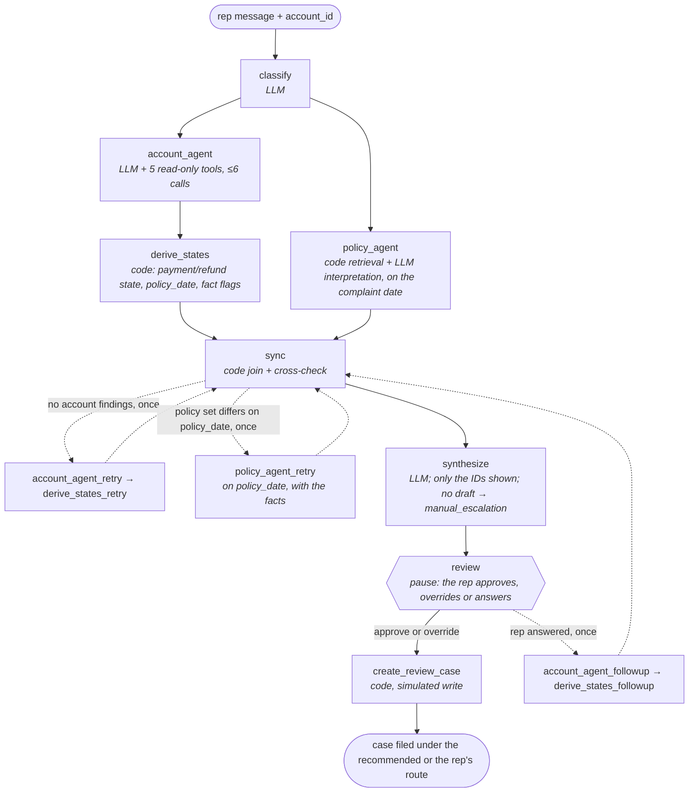

# Auto-finance payment dispute agent

A LangGraph agent that investigates a customer's payment dispute and drafts a review case for a human rep. Everything is fictional: the lender, Agarwal Motor Finance, and all of its data.

## Start here

1. **[Project brief](docs/project_brief.md)**: the problem, what the agent produces, the data and how it's evaluated.
2. **[Architecture diagram](docs/diagrams/architecture.png)**: the whole system on one page.
3. **[Architecture walkthrough](docs/architecture.md)**: each box of the diagram in detail.

## The graph

Code decides what runs next; the LLM classifies, runs the two agents and drafts. Dashed edges run at most once. Built in [graph.py](dispute_agent/orchestrator/graph.py).



## Design notes

- **Code runs the workflow; the LLM handles language.** The LLM reads messy complaints, rep notes and policy prose. Code picks the next step, derives payment state and checks dates, so rules that must always hold don't depend on a model.
- **A fixed graph, not an LLM supervisor.** Every first run takes one of four shapes, and the attempt counts in state say which, so traces compare cleanly. A supervisor is worth adding only if evals show the fixed graph is what fails.
- **Two agents in parallel, re-requests capped at one.** The Account and Policy Agents don't need each other to start. Sync can send each back once, then the run continues and records what's missing, so it can't loop.
- **Citations limited by the schema.** Synthesize's output schema accepts only the event and section IDs it was shown, so the wrong-account trap holds by construction, not by prompt. No valid draft means `manual_escalation`.
- **Human review inside the graph.** The graph pauses before its one write, and a checkpointer saves state, so the rep can approve, override or answer later, even from a new process.
- **Checks in the eval, not at runtime.** The P1–P7 policy checks are plain Python over event fields: they score every route without an answer key and audited the labels. Opus judges the case notes, so Sonnet isn't grading its own work.

## Repo layout

```
dispute_agent/          the agent: one folder per diagram box
  __main__.py           the CLI: show, ask, resume, eval, judge, calibrate, report, langsmith-sync, stability, trace
  config.py, data.py    shared settings and record types
  evaluation/           outside the run: scorer, P1–P7 policy checks, Opus judge, golden and release workbooks
app/                    the web app: server.py + narrate.py (Python), src/ (React), Vite config
tests/                  one test file per source file, no LLM calls; shared fakes in conftest.py
data/                   synthetic Excel data and policies/ (the policy documents the Policy Agent searches)
docs/                   brief, architecture, data contract, validation results, diagrams/
docs/plans/             the build plan for each slice, as written at the time (history; file paths predate this layout)
runs/                   git-ignored output: eval reports and checkpoints.sqlite (paused runs). Safe to delete
```

## Quickstart

```bash
python -m venv .venv && source .venv/bin/activate
pip install -r requirements.txt
cp .env.example .env   # add your Anthropic and LangSmith keys
```

## Try it in the web app

```bash
python -m app.server                  # terminal 1: the API on 127.0.0.1:8000
cd app && npm ci && npm run dev       # terminal 2: open http://localhost:5173
```

If port 8000 is taken, run `python -m app.server --port 8010` and `API_PORT=8010 npm run dev`.

1. Pick a complaint from the inbox. It holds the 12 dev scenarios by account number, never the held-out four or the answer key.
2. The complaint fills the composer as the rep's message. Edit it if you like, then send.
3. The reply shows each step as it runs, then the recommended route, the case note and its sources.
4. Approve it, override the route with a reason, or, on `need_more_evidence`, answer the open questions in the composer.

"New conversation" starts a complaint on any account. Every run is traced in LangSmith under the `LANGSMITH_PROJECT` in `.env`.

## Command line

```bash
python -m dispute_agent show A-1002            # one account's events, notes and cases (no LLM)
python -m dispute_agent ask A-1002 "cust got hit w a late fee on oct but says he paid over the phone last tues"
python -m dispute_agent resume <thread> --approve   # or --route <route> --reason "...", or --answer "..."
python -m dispute_agent eval --split dev       # score the 12 dev scenarios, about $0.75
python -m pytest                               # offline tests, no LLM calls
```

`ask` pauses for review and prints the thread ID to resume. Paused runs are saved in `runs/checkpoints.sqlite`, which the web app shares, so a thread paused in the page can be resumed with `resume`. `eval` never pauses: it approves every run, so its scores measure the agent. Judging, release workbooks and the LangSmith experiment are in the [evaluation README](dispute_agent/evaluation/README.md).
