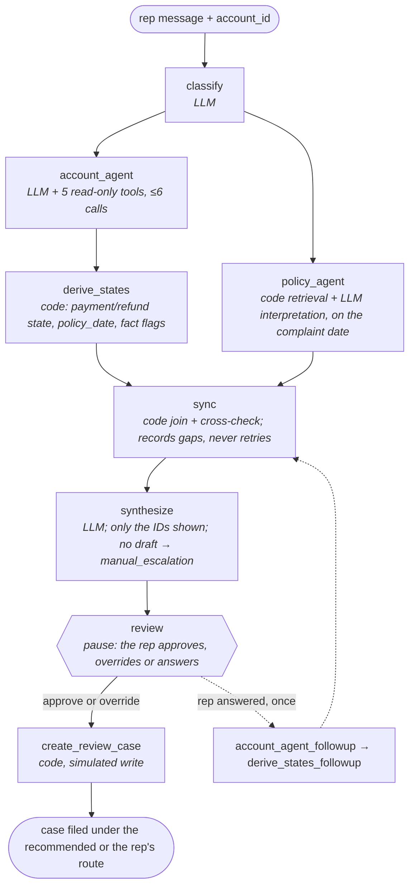

# Auto-finance payment dispute agent

A LangGraph agent that investigates a customer's payment dispute and drafts a review case for a human rep. Everything is fictional: the lender, Agarwal Motor Finance, and all of its data.

## The problem

A servicing rep at an auto lender gets complaints like "I was charged a late fee but autopay was on." Today the rep digs through the account history, rereads notes from earlier calls, checks policy and writes up a case by hand.

The agent does the digging. It drafts one review case: the recommended human queue (`adjustment_review`, `explain_events`, `need_more_evidence` or `manual_escalation`), the account events and policy sections behind it, and a case note. The rep approves it, overrides it or answers its questions. The agent never moves money. Full brief: [project_brief.md](docs/project_brief.md).

## Recording

**[Screen recording](#)** _(link to add)_: a complaint from the inbox, the agent's steps as they stream, the review pause, and the trace in LangSmith.

## The graph

**Start with the [architecture diagram](docs/diagrams/architecture.png).** It explains the whole system on one page: the graph, both agents, their tools and where the human review sits.

[](docs/diagrams/architecture.png)

Code decides what runs next; the LLM classifies, runs the two agents and drafts. Every run takes the solid path; the dashed edge runs only when the rep answers an open question, at most once. Built in [graph.py](dispute_agent/orchestrator/graph.py).



## Evaluation results

**[See the results in LangSmith](https://smith.langchain.com/public/49bdd689-1b76-49fd-8d2d-2cc19bd1f452/d/compare?selectedSessions=fe12ec99-02aa-4357-92ea-16a793c49737)** (public, no login): the release experiment on the `dispute-agent-golden` dataset. One row per scenario (all 16), the six code-graded axes and the four judge scores as columns. Judge scores show as a fraction of 3 (0.67 is 2 of 3); hover one for the judge's reason. Click a row to open its trace: the complaint, both agents' tool and model calls, and the draft.

The same run is also available locally as a workbook ([`release_2026-10-27_v0.8.xlsx`](dispute_agent/evaluation/reports/release_2026-10-27_v0.8.xlsx)), which adds slices by tag. How each metric is scored is in the [evaluation README](dispute_agent/evaluation/README.md).

## Design notes

- **Code runs the workflow; the LLM handles language.** The LLM reads messy complaints, rep notes and policy prose. Code picks the next step, derives payment state and checks dates, so rules that must always hold don't depend on a model.
- **A fixed graph, not an LLM supervisor.** Every run takes the same path, so traces compare cleanly. A supervisor is worth adding only if evals show the fixed graph is what fails.
- **Two agents in parallel, no retries.** The Account and Policy Agents don't need each other to start. Sync records whatever doesn't line up and leans the draft to a cautious route; nothing is sent back, so the run can't loop.
- **Citations limited by the schema.** Synthesize's output schema accepts only the event and section IDs it was shown, so the wrong-account trap holds by construction, not by prompt. No valid draft means `manual_escalation`.
- **Human review inside the graph.** The graph pauses before its one write, and a checkpointer saves state, so the rep can approve, override or answer later, even from a new process.
- **Checks in the eval, not at runtime.** The P1–P7 policy checks are plain Python over event fields: they score every route without an answer key and audited the labels. Opus judges the case notes, so Sonnet isn't grading its own work.

## Known failures and what I'd improve

- **S-07's note can be empty or can leak.** The draft sometimes cites Andrea Bellow's payment; the schema rejects it, so the route falls back to `manual_escalation` with no case note (3 of 8 runs since the last prompt fix). In the latest release the draft cited only the right events, but the note's text still named her account and payment reference; the code checks read cited IDs, not prose, so only the judge caught it (`no_leaks_or_promises`). The route is right either way. Next: one bounded synthesize retry that passes back the rejection reason, and a code check for other-account IDs in the note text.
- **S-11 picks the wrong queue.** The customer blames his bank for a returned payment; only a bank letter can settle it, so the key says `need_more_evidence`. The agent says `explain_events` in 18 of 20 runs, even though its note asks for a bank letter. Not yet fixed.
- **Two held-out scenarios miss a policy section.** S-04 and S-12 get the route right but miss a required policy section. Seen on both held-out passes; nothing was tuned on them.
- **The judge is calibrated only at the ceiling.** Ten of twelve hand-scored notes were near-perfect, so agreement shows the judge doesn't invent failures. It has since caught one real leak (S-07), but it hasn't been tested on deliberately broken notes. Next: grade deliberately broken notes (an invented amount, a mention of the other customer, a promised refund) and check it drops the right axis.
- **No baseline.** A code-only version on the same scenarios would show what the LLM steps add.
- **Small sets.** Four held-out scenarios are a sanity check, not a measurement, and slices of six or fewer are directional only.

### In production

- **Score every live case without an answer key.** `policy_consistent` checks the route against P1–P7 on the agent's own facts, so it can run as an online evaluator on each trace.
- **Treat the rep's decision as the label.** Approve versus override, and the override reason, give route accuracy over time; overridden cases become new golden scenarios.
- **Judge a sample of filed notes,** and recalibrate the judge against rep-scored notes each release.
- **Watch the traces.** No-draft rate, sync issue rate, tool-budget hits, cost and latency per case, from LangSmith.
- **Measure time saved per case** against a manual baseline; it is a hypothesis, not a claimed result.

## Quickstart

```bash
python -m venv .venv && source .venv/bin/activate
pip install -r requirements.txt
cp .env.example .env   # add your Anthropic and LangSmith keys
python -m dispute_agent ask A-1002 "cust got hit w a late fee on oct but says he paid over the phone last tues"
```

`ask` pauses for review and prints a thread ID; `python -m dispute_agent resume <thread> --approve` files the case.

<details>
<summary><b>Try it in the web app</b></summary>

```bash
python -m app.server                  # terminal 1: the API on 127.0.0.1:8000
cd app && npm ci && npm run dev       # terminal 2: open http://localhost:5173
```

If port 8000 is taken, run `python -m app.server --port 8010` and `API_PORT=8010 npm run dev`.

1. Pick a complaint from the inbox. It holds the 12 dev scenarios by account number, never the held-out four or the answer key.
2. The complaint fills the composer as the rep's message. Edit it if you like, then send.
3. The reply shows each step as it runs, then the recommended route, the case note and its sources.
4. Approve it, override the route with a reason, or, on `need_more_evidence`, answer the open questions in the composer.

"New conversation" starts a complaint on any account. Every run is traced in LangSmith under the `LANGSMITH_PROJECT` in `.env`.

</details>

<details>
<summary><b>Command line</b></summary>

```bash
python -m dispute_agent show A-1002            # one account's events, notes and cases (no LLM)
python -m dispute_agent ask A-1002 "cust got hit w a late fee on oct but says he paid over the phone last tues"
python -m dispute_agent resume <thread> --approve   # or --route <route> --reason "...", or --answer "..."
python -m dispute_agent eval --split dev       # score the 12 dev scenarios, about $0.75
python -m pytest                               # offline tests, no LLM calls
```

Paused runs are saved in `runs/checkpoints.sqlite`, which the web app shares, so a thread paused in the page can be resumed with `resume`. `eval` never pauses: it approves every run, so its scores measure the agent. Judging, release workbooks and the LangSmith experiment are in the [evaluation README](dispute_agent/evaluation/README.md).

</details>

<details>
<summary><b>Repo layout</b></summary>

```
dispute_agent/          the agent: one folder per diagram box
  __main__.py           the CLI: show, ask, resume, eval, judge, calibrate, report, langsmith-sync, stability, trace
  config.py, data.py    shared settings and record types
  evaluation/           outside the run: scorer, P1–P7 policy checks, Opus judge, golden and release workbooks
app/                    the web app: server.py + narrate.py (Python), src/ (React), Vite config
tests/                  one test file per source file, no LLM calls; shared fakes in conftest.py
data/                   synthetic Excel data and policies/ (the policy documents the Policy Agent searches)
docs/                   brief, architecture, data contract, diagrams/
docs/history/           the build plan for each slice and the validation log, as written at the time (file paths predate this layout)
runs/                   git-ignored output: eval reports and checkpoints.sqlite (paused runs). Safe to delete
```

</details>
