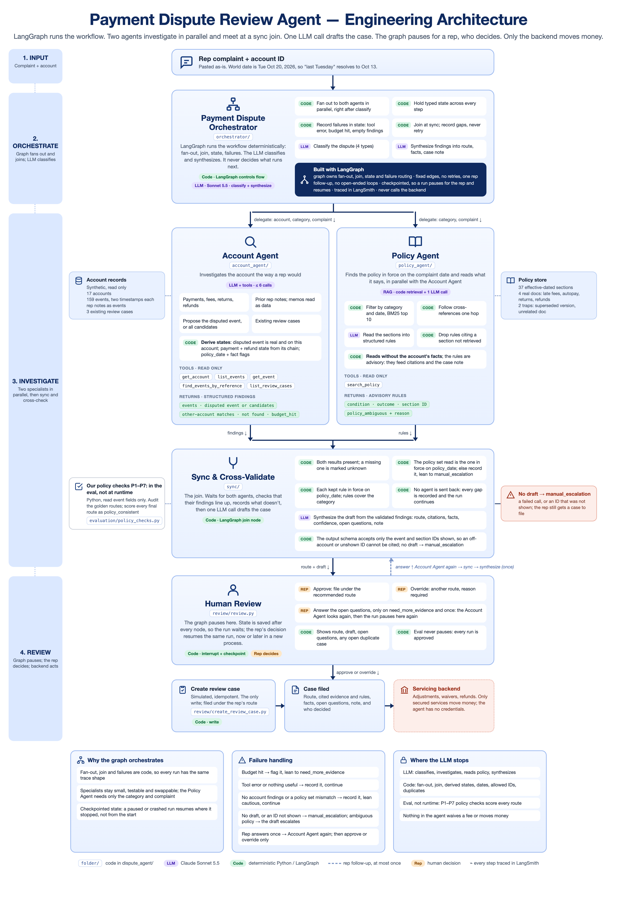

# Auto-finance payment dispute agent

A LangGraph agent that investigates a customer's payment dispute and drafts a review case for a human rep. The lender (Agarwal Motor Finance) and all its data are fictional.

**[▶ Watch the 3-minute demo](docs/demo.mp4)** — the web app investigating a complaint end to end, from intake to the rep's review.

## What it does

A servicing rep at an auto lender gets complaints like "I was charged a late fee but autopay was on." Today the rep digs through the account history, rereads notes from earlier calls, checks the policy and writes up a case by hand.

The agent does the digging. For each complaint it drafts one review case with:

- **A recommended queue,** one of four:
  - `adjustment_review`: the customer may be right; someone with authority should look at a correction.
  - `explain_events`: the records and policy explain what happened; the rep walks the customer through it.
  - `need_more_evidence`: something critical is missing, usually from the customer.
  - `manual_escalation`: records conflict, evidence points at the wrong account, or policy is unclear.
- **The evidence:** the account events and policy sections behind the recommendation, each one cited.
- **A case note** the rep can read in a minute.

The rep then approves it, overrides the queue with a reason, or answers the agent's open questions. The agent never moves money. Full brief: [project_brief.md](docs/project_brief.md).

## How it works

[](docs/diagrams/architecture.png)

An orchestrator runs two agents in parallel (Account and Policy), joins their findings, drafts the case and pauses for the rep. Details: [architecture.md](docs/architecture.md).

## Results

**12 of 16 test complaints pass every check** in the release run of 2026-10-28, the current code. Code grades each complaint against the answer key (queue, disputed event, evidence, policy, confidence, guardrails); Claude Opus 5.5 grades each case note. The four that fail:

| Complaint | Split | What failed |
|---|---|---|
| S-04 (injection trap) | held out | Right queue; the draft omits `AP.v1.s5` |
| S-07 (wrong-account trap) | dev | Right queue, but no case note: the draft tried to cite the other customer's event, the schema rejected it, and the run fell back to `manual_escalation`. A known flake, see below |
| S-11 (duplicate trap) | dev | Wrong queue: `explain_events` where only a bank letter can settle it (`need_more_evidence`) |
| S-12 | held out | Right queue; the draft omits `RR.v1.s8` |

**[All 16, one row and one LangSmith trace each →](docs/results.md)** · the same run as a [public LangSmith experiment](https://smith.langchain.com/public/49bdd689-1b76-49fd-8d2d-2cc19bd1f452/d/compare?selectedSessions=0cb67e9d-df79-48fe-a951-19f69515bf77), one row per complaint with its trace and the 13 scores. The previous day's run on the same scenarios ([experiment](https://smith.langchain.com/public/49bdd689-1b76-49fd-8d2d-2cc19bd1f452/d/compare?selectedSessions=fe12ec99-02aa-4357-92ea-16a793c49737)) scored 13 of 16: the same S-04, S-11 and S-12 misses, with S-07 writing a draft that time.

**What these numbers can and cannot say.** The held-out set is four complaints (S-04, S-08, S-12, S-16). It has been run three times after tuning with nothing changed in between, and S-04 and S-12 missed the same policy section every time, so those are real misses, not noise. But four held-out and twelve dev complaints, all hand-written, show that the traps hold on this data; they do not measure accuracy on real complaints.

## Evaluation-driven improvements

Every change to the agent was made because an eval run showed a failure, and each was checked by re-running the same scenarios. The run files are in `runs/` (git-ignored; the timestamps below name them) and the full log is in [docs/history/](docs/history/).

| Date | What the eval showed | What changed, and why | Before → after |
|---|---|---|---|
| 10-25 | New checks for the two traps showed the Account Agent treating S-07's payment on another account as this customer's, and S-06's look-alike reference as a match | One prompt change: an other-account match means "maybe this customer's payment on the wrong account"; "claimed but not found" means transactions only | Disputed event 11/12 → 12/12, fact gaps 10/12 → 12/12 (`account_agent_20261025T223538Z` → `T223813Z`); S-06 stayed wrong until the null-disputed rule was narrowed on 10-26 (`eval_20261026T163446Z`: 12/12 on every check) |
| 10-26 | First full-graph run: S-07's draft cited `E-0135`, the other customer's event; a code gate caught it after the fact | The draft's output schema is built per call and accepts only the IDs the model was shown, so an off-account citation is impossible rather than caught | Draft policy 10/12 → 12/12 (`eval_20261026T194129Z` → `T201450Z`); S-07 no longer needed a rescue |
| 10-26 | S-11 routes `explain_events` instead of `need_more_evidence` | **Tried and reverted:** one sentence in the synthesize prompt ("proof only the customer or bank can supply") fixed S-11 in both runs but flipped S-10 and S-14 to wrong routes in both | Route 11/12 → 10/12 (`T201957Z`, `T202450Z`), so the sentence came out and S-11 stayed a known miss |
| 10-27 | A three-run stability matrix put S-07's policy citation at 1/3: `LF.v3.s6` states two rules and the Policy Agent kept only the first | The Policy Agent reads one rule per condition, not one per section. The first wording made it skip the explanatory refund sections (S-14 fell to 0/3), so it was reworded to keep those | S-07 1/3 → 3/3 and S-14 3/3 → 0/3 → 3/3 across three matrices (`T224024Z..`, `T014852Z..`, `T022319Z..`); details in [validation.md](docs/history/validation.md) |
| 10-27 | Across 279 scored rows the runtime gate rejected 8 drafts and never changed a route: every rejected draft had already chosen `manual_escalation` | The gate node was removed; its P1–P7 checks moved into the eval as `policy_consistent`, where they score every route without an answer key | Three passes after: route 11/12 (S-11), every other check 12/12, no flaky cells (`T182359Z`, `T182756Z`, `T183153Z`) |
| 10-27 | All 16 as a LangSmith experiment, with the judge. Every code check passed S-07, but the Opus judge scored its note 1/3 on leaks: the prose named the other customer's account, event and payment reference | Code now redacts another customer's account ID, an unshown event ID or another account's reference from the case note and open questions, and records what it removed ([synthesize.py](dispute_agent/sync/synthesize.py), `redact_prose`) | Offline: the exact leaked sentence ([test_synthesize.py](tests/test_synthesize.py)). Live: S-07 wrote no draft in the 10-28 release run, so it was run alone three more times (`eval_20261028T155541Z`, `T155558Z`, `T155618Z`): a draft each time, the redaction fired in two, and the judge scored the redacted note 3/3 on leaks (was 1/3), 2/3 on ready-to-file because the `[redacted ...]` placeholders read like template text (`judge_20261028T155758Z`) |

**Still unresolved**

- **S-11:** wrong queue in every one of about 20 runs since 10-26. The one prompt fix tried broke two other scenarios. Next: a code check that a disputed return with no bank letter cannot route `explain_events`.
- **S-04 and S-12 (held out):** one policy section missing from the draft in both held-out captures. Nothing is tuned on them, by design.
- **S-07 can return no draft:** in 4 of 12 runs since the one-rule-per-condition change, including the 10-28 release run, the draft cited `E-0135`, the schema rejected it, and the rep got the right queue with an empty note. One bounded retry is the obvious fix and is not built.
- **S-02 classification flake:** 1 run in 3 classified it `missing_payment`; the queue still held.

## Key design choices

- **Code decides what runs next; the LLM handles language.** Rules that must always hold never depend on a model.
- **Two agents in parallel, no retries.** A mismatch is recorded and pushes the case to a cautious queue, so a run can't loop.
- **The draft can only cite what it was shown.** The output schema rejects any other event or policy ID, so wrong-account evidence can't get in.
- **The human review is inside the graph.** It pauses before its one write and can be resumed later.

Reasoning for each, plus retrieval and policy dates: [architecture.md § Design decisions](docs/architecture.md#design-decisions).

## Known gaps

- **S-11 picks the wrong queue.** It says `explain_events` where only a bank letter can settle it (`need_more_evidence`).
- **S-07's note named another customer's account.** The schema blocked the wrong IDs, not the prose; only the judge caught it. Code now redacts those details from the note (see above), and the judge scores the redacted note clean on leaks, though the placeholders cost a point on readiness. The other account still appears in the Account Agent's own summary inside the trace, which the rep's page does not show.
- **The judge is untested on bad notes.** Next: grade deliberately broken notes and check the score drops.
- **No code-only baseline, and small sets.** Four held-out scenarios are a sanity check, not a measurement.

How I'd run this in production: [evaluation README § In production](dispute_agent/evaluation/README.md#in-production).

## Quickstart

**1. Set up**, then add your Anthropic and LangSmith keys to `.env`:

```bash
make setup
```

<details><summary>Without <code>make</code></summary>

```bash
python3 -m venv .venv && source .venv/bin/activate
pip install -r requirements.txt
cp .env.example .env
```

</details>

**2. Run the web app** (no Node needed):

```bash
make run        # or: .venv/bin/python -m app.server
```

The inbox opens in your browser, and the terminal prints its address.

1. Pick a complaint from the inbox. It holds the 12 dev scenarios by account number, never the held-out four or the answer key.
2. Send it. The reply shows each step as it runs, then the recommended queue, the case note and its sources.
3. Approve it, override the queue with a reason, or, on `need_more_evidence`, answer the open questions.

"New conversation" starts a complaint on any account. It uses port 8000, or the next free one. Working on the page itself? `cd app && npm run dev` (Node) gives hot reload on :5173.

**Or from the terminal:**

```bash
source .venv/bin/activate
python -m dispute_agent ask A-1002 "cust got hit w a late fee on oct but says he paid over the phone last tues"
python -m dispute_agent resume <thread> --approve   # ask prints the thread ID
```

Every run is traced in LangSmith under the `LANGSMITH_PROJECT` in `.env`.

<details>
<summary><b>All commands</b></summary>

```bash
python -m dispute_agent show A-1002            # one account's events, notes and cases (no LLM)
python -m dispute_agent ask A-1002 "cust got hit w a late fee on oct but says he paid over the phone last tues"
python -m dispute_agent resume <thread> --approve   # or --route <route> --reason "...", or --answer "..."
python -m dispute_agent eval --split dev       # score the 12 dev scenarios, about $0.75
python -m pytest                               # offline tests, no LLM calls
```

Paused runs are saved in `runs/checkpoints.sqlite`, which the web app shares, so a thread paused in the page can be resumed with `resume`. `eval` never pauses: it approves every run, so its scores measure the agent. Judging, release workbooks and the LangSmith experiment are in the [evaluation README](dispute_agent/evaluation/README.md).

</details>

<details>
<summary><b>Repo layout</b></summary>

```
dispute_agent/          the agent: one folder per diagram box
  __main__.py           the CLI: show, ask, resume, eval, judge, calibrate, report, langsmith-sync, stability, trace
  config.py, data.py    shared settings and record types
  evaluation/           outside the run: scorer, P1–P7 policy checks, Opus judge, golden and release workbooks
app/                    the web app: server.py + narrate.py (Python), src/ (React), Vite config
tests/                  one test file per source file, no LLM calls; shared fakes in conftest.py
data/                   synthetic Excel data and policies/ (the policy documents the Policy Agent searches)
docs/                   brief, architecture, data contract, diagrams/
docs/history/           the build plan for each slice and the validation log, as written at the time (file paths predate this layout)
runs/                   git-ignored output: eval reports and checkpoints.sqlite (paused runs). Safe to delete
```

</details>
