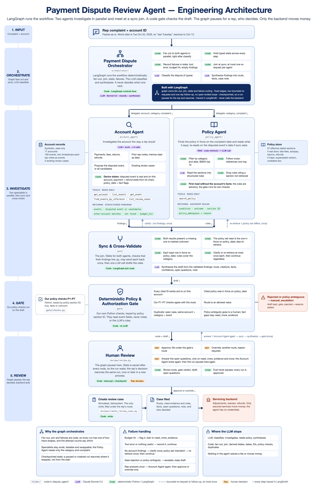

# Auto-finance payment dispute agent

A LangGraph agent that investigates a customer's payment dispute and drafts a review case for a human rep. Everything is fictional: the lender, Agarwal Motor Finance, and all of its data.

## Start here: read in this order

1. **[Project brief](docs/project_brief.md)**: the problem, and what the agent produces.
2. **The diagram below, then [architecture.md](docs/architecture.md)**: every step, and which ones are LLM and which are plain code.
3. **[The data](data/README.md)**: the synthetic accounts, events, review cases, eval scenarios and [policy documents](data/policies/). The [data contract](docs/data_contract.md) defines every column.
4. **The code, in run order**: each box of the diagram is one folder in [`dispute_agent/`](dispute_agent/), and each folder's `__init__.py` lists its files in reading order. Start at [`orchestrator/graph.py`](dispute_agent/orchestrator/graph.py).
5. **[Validation results](docs/validation.md)**: how the agent scores, run to run.



## Where each box of the diagram lives

"Code" means plain Python with no LLM. Every graph node lives in the file named after it.

| # | Diagram box | Folder | Files, in reading order | Who |
|---|---|---|---|---|
| 1 | Input: complaint + account | [`__main__.py`](dispute_agent/__main__.py) | The `ask` command takes the account ID and the rep's message | Rep |
| 2 | Orchestrator | [`orchestrator/`](dispute_agent/orchestrator/) | [`graph.py`](dispute_agent/orchestrator/graph.py) the nodes and edges · [`classify.py`](dispute_agent/orchestrator/classify.py) the category · [`run.py`](dispute_agent/orchestrator/run.py) start, resume, run unattended | Code (LangGraph) + one LLM call |
| 3a | Account Agent | [`account_agent/`](dispute_agent/account_agent/) | [`agent.py`](dispute_agent/account_agent/agent.py) the tool loop · [`tools.py`](dispute_agent/account_agent/tools.py) 5 read-only tools · [`derive.py`](dispute_agent/account_agent/derive.py) derive_states | LLM + tools, then code |
| 3b | Policy Agent | [`policy_agent/`](dispute_agent/policy_agent/) | [`retrieve.py`](dispute_agent/policy_agent/retrieve.py) search the policy files · [`agent.py`](dispute_agent/policy_agent/agent.py) read them into rules | Code, then one LLM call |
| 3c | Sync & cross-validate | [`sync/`](dispute_agent/sync/) | [`sync.py`](dispute_agent/sync/sync.py) the join's cross-check · [`synthesize.py`](dispute_agent/sync/synthesize.py) the draft | Code, then one LLM call |
| 4 | Gate | [`gate/`](dispute_agent/gate/) | [`gate.py`](dispute_agent/gate/gate.py) checks the draft · [`checks.py`](dispute_agent/gate/checks.py) our P1–P7 policy checks | Code |
| 5 | Human review, create review case | [`review/`](dispute_agent/review/) | [`review.py`](dispute_agent/review/review.py) the pause and the rep's three actions · [`create_review_case.py`](dispute_agent/review/create_review_case.py) the only write | Rep, then code |

Shared by every box: [`data.py`](dispute_agent/data.py) (record types and the Excel loader for [`data/`](data/)) and [`config.py`](dispute_agent/config.py) (model ID, the fictional "today", limits).
Outside the run: [`evaluation/`](dispute_agent/evaluation/) scores the scenarios ([`evaluate.py`](dispute_agent/evaluation/evaluate.py)) and checks stability and LangSmith traces ([`validate.py`](dispute_agent/evaluation/validate.py)).
Also outside the run: [`app/`](app/) is the rep's web page. [`server.py`](app/server.py) streams the same graph's steps, and [`narrate.py`](app/narrate.py) turns each node into a plain-language line marked AI, code or you.

## Repo layout

```
dispute_agent/          the agent: one folder per diagram box (table above)
app/                    the web page: server.py + narrate.py (Python), src/ (React), Vite config
  __main__.py           the CLI: show, ask, resume, eval, stability, trace
  config.py, data.py    shared settings and record types
tests/                  one test file per source file, no LLM calls; shared fakes in conftest.py
data/                   synthetic Excel data and policies/ (the policy documents the Policy Agent searches)
docs/                   brief, architecture, data contract, validation results, diagrams/
docs/plans/             the build plan for each slice, as written at the time (history; file paths predate this layout)
runs/                   git-ignored output: eval reports and checkpoints.sqlite (paused runs). Safe to delete
```

| Test file | Tests |
|---|---|
| [`test_graph.py`](tests/test_graph.py) | the graph's order, fan-out, join and both re-requests |
| [`test_review.py`](tests/test_review.py) | the review pause, resume across processes, recovery, the `resume` command |
| [`test_account_agent.py`](tests/test_account_agent.py), [`test_tools.py`](tests/test_tools.py), [`test_derive.py`](tests/test_derive.py) | the Account Agent folder |
| [`test_policy_agent.py`](tests/test_policy_agent.py) | the Policy Agent folder: retrieval and the reading |
| [`test_sync.py`](tests/test_sync.py), [`test_synthesize.py`](tests/test_synthesize.py) | the sync folder |
| [`test_gate.py`](tests/test_gate.py) | the gate and its P1–P7 checks, on all 16 scenarios |
| [`test_create_review_case.py`](tests/test_create_review_case.py) | the write: duplicates and the rep's override |
| [`test_narrate.py`](tests/test_narrate.py), [`test_server.py`](tests/test_server.py) | the web app: the step labels and the HTTP contract |
| [`test_data.py`](tests/test_data.py), [`test_evaluate.py`](tests/test_evaluate.py), [`test_validate.py`](tests/test_validate.py) | the loader and the evaluation tools |

## Run it

```bash
python -m venv .venv && source .venv/bin/activate
pip install -r requirements.txt
cp .env.example .env   # add your Anthropic and LangSmith keys

python -m dispute_agent show             # list accounts (no LLM)
python -m dispute_agent show A-1002      # one account's events, notes and cases (no LLM)
python -m dispute_agent ask A-1002 "cust got hit w a late fee on oct but says he paid over the phone last tues"
#   ...prints each step, then pauses:  paused for review: thread A-1002-20261027T101500Z
python -m dispute_agent resume A-1002-20261027T101500Z --approve          # file under the gate's route
python -m dispute_agent resume <thread> --route manual_escalation --reason "..."   # or override it
python -m dispute_agent resume <thread> --answer "the \$731.50 refund"     # need_more_evidence only, once
python -m dispute_agent ask A-1002 "..." --approve                        # approve at the pause, no resume
python -m dispute_agent eval --split dev --min-disputed-acc 0.75 --min-policy-recall 0.75 --min-route-acc 0.75
python -m dispute_agent stability runs/eval_*.json --known S-11:route_ok
python -m dispute_agent trace --last 12
pytest
```

### Web app

```bash
python -m app.server                  # API on 127.0.0.1:8000 (--port to change)
cd app && npm ci && npm run dev       # the page on http://localhost:5173 (API_PORT=... if the API is not on 8000)
```

The inbox holds the 12 dev complaints (never the held-out four, never the answer key), shown by account number.
Opening one puts the complaint in the composer as the rep's message; the rep edits it and sends, and the assistant
replies in the conversation: a phase bar and each step inline while it works, then the recommended route, the case
note, its sources and the Approve / Override buttons. Open questions are answered in the composer. "New conversation"
starts a complaint on any account. Runs share
`runs/checkpoints.sqlite` with the CLI, so a thread paused in the page can be resumed with `resume`.

Every `ask` pauses at the `review` node; its state is saved in `runs/checkpoints.sqlite`, so `resume` can continue it
later in a new process. `eval` never pauses: it approves every run, so its scores measure the agents and the gate.

For live validation only, `DISPUTE_FAULT=finalize_once` forces the Account Agent's first result to be retried;
`DISPUTE_FAULT=policy_date_mismatch` forces the Policy Agent re-retrieval path. The variable is off by default and
`eval` refuses to run while it is set.
