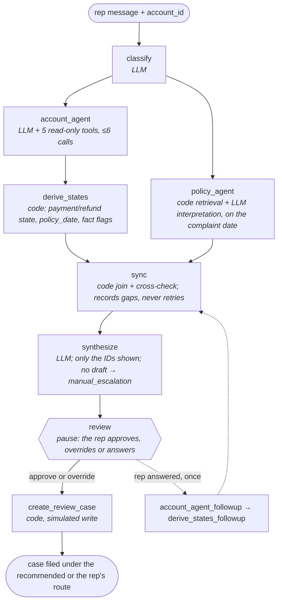

# Architecture

## In one paragraph

A rep pastes a customer's complaint and the account ID. The **orchestrator** is a LangGraph graph: code, not the LLM, decides what runs next. It calls the LLM for two jobs of its own, naming the dispute type and synthesizing the findings into a draft, and sends two specialist agents out **in parallel**. The **Account Agent** investigates the account and proposes the disputed event; code then derives the payment and refund states from that event's chain. The **Policy Agent** retrieves the policy sections in force on the complaint date, and one LLM call turns them into structured rules with citations. A **sync step** in code is the join where both agents report back. It confirms the two sets of findings line up and records anything that doesn't; it never sends an agent back. One LLM call then **synthesizes** the draft. Its output schema accepts only the event and section IDs it was shown, and if no draft comes back the route falls back to `manual_escalation`. The graph then **pauses for a human rep**, who approves, overrides or answers once. Only then does the agent's one write create a simulated review case. Money moves only in the **servicing backend**, which the agent cannot reach.

## The four layers

| # | Layer | Who | Does |
|---|---|---|---|
| 1 | **Input** | Rep | Pastes the complaint; the account ID comes from the rep's screen, never guessed |
| 2 | **Orchestrate** | LangGraph (code), LLM for two calls | Code: fan out to both agents, hold state, record failures, sync. LLM: classify, synthesize the draft |
| 3 | **Investigate** | Two agents in parallel, then a code join | Account Agent reads records and notes and finds the disputed event; Policy Agent retrieves and interprets the rules; sync cross-checks both |
| 4 | **Review** | Human, inside the graph; then the backend | The graph pauses; the rep approves, overrides or answers once; the case is filed. Only the secured backend moves money |

## The graph

After classify, the two agents run in parallel and meet at sync, a join node. Sync never sends an agent back: every failure is written to state, not branched on, and the run continues. The route is the draft's, or `manual_escalation` when synthesize returns no draft. The graph then **pauses at `review`** for the rep. `after_review` either files the case or, when the rep answered, sends the Account Agent back once through its own follow-up nodes (the dashed edge). They are separate nodes because re-entering the fan-out nodes would hit the join barrier and end the run silently. Built as a `StateGraph` in [graph.py](../dispute_agent/orchestrator/graph.py) and compiled with a checkpointer, so a paused run can resume later. Each `invoke` is one parent trace.

---

## 2. Orchestrator — LangGraph, with two LLM calls

Code: [`dispute_agent/orchestrator/`](../dispute_agent/orchestrator/)

**The graph owns the run.** Workflow order, state and failure handling are deterministic code. The LLM never decides what runs next.

| Responsibility | Owner | How |
|---|---|---|
| **Classify** | LLM | One call picks `late_fee_autopay`, `missing_payment`, `returned_reversed_payment` or `refund_status` |
| **Delegate** | Code | Sends the account, category and complaint to the Account Agent, and the category and complaint to the Policy Agent, at the same time |
| **Track state** | Code | One typed state object; each step adds its own fields (see Graph state below) |
| **Handle failures** | Code | A budget hit, the exact text of a tool error, or "found nothing useful" is recorded in state and the run continues; that finding counts as unknown |
| **Sync** | Code | Joins both agents' findings, cross-checks them, and records what doesn't line up. See 3c |
| **Synthesize** | LLM | One structured-output call after sync: route, cited events and sections, facts, confidence, open questions, case note. If the draft is rejected (an ID that was not shown), one more call with the rejection appended, then `manual_escalation` |
| **Hand off** | Code | The draft and its route go to the review pause. The orchestrator never calls the backend |

**Fixed graph shape.** Every run goes through classify, both agents, sync, synthesize, the review pause and the write. Nothing chooses at runtime which agents to call, and no node is re-entered, so every first run has the same shape. Inside the Account Agent the LLM does choose its own tool calls, from one to six, and inside synthesize a rejected draft gets one more LLM call (`MAX_ATTEMPTS = 2`); the fixed part is the outer graph. An LLM supervisor that picks agents or loops until satisfied is the next step if evals show it is needed.

**Why in parallel.** The two investigations are independent until sync: the Policy Agent needs only the category and the complaint. Reading policy on the complaint date is right whenever the same policy set was in force on the disputed event's date. Sync checks that in code; when it differs, the run records it and the draft leans to `manual_escalation`. On the current data it never differs, since every disputed event falls after the current late-fee policy's start. The cost is a policy read without the account's facts. The rules are advisory, so that read only shapes the citations and the case note.

## 3a. Account Agent — LLM with read-only tools, max 6 calls

Code: [`dispute_agent/account_agent/`](../dispute_agent/account_agent/)

**Investigates the account the way a rep would**: payments, fees, returns, reversals, refunds and prior rep notes. Every event has two timestamps, so out-of-order cases are decidable.

| Tool | Returns | Notes |
|---|---|---|
| `get_account` | The account row, including `memo` | The memo can hold an injection trap (A-1004) |
| `list_events` | Events on this account | Both timestamps, the link to the earlier event, memo |
| `get_event` | One event by ID | |
| `find_events_by_reference` | Events whose reference matches, including partial matches, **across all accounts**, each tagged with its account | Otherwise the S-07 payment keyed to another customer could never be found. The draft still cannot cite it: `derive_states` drops it and the schema accepts only shown IDs |
| `list_review_cases` | Existing cases on this account | Feeds the duplicate check |

**Returns structured findings:** the events it found; the disputed event, or **all candidates** if more than one fits and the complaint doesn't say which; reference matches on other accounts; what it couldn't find; and a budget-hit flag if it ran out of tool calls. A capped run must not look like a confident one.

**Then code, in `derive_states`:**

| Step | How |
|---|---|
| Confirm the disputed event | It must exist and be on this account; otherwise it is recorded as unknown |
| Derive states | `payment_state` and `refund_state` from the disputed event's chain. The LLM picks the event; code works out what happened to it |
| Set `policy_date` | The disputed event's `occurred_at`; with no single disputed event, the complaint date (Oct 20, 2026). `policy_date_basis` records which |
| Set fact flags | `fact_gap` (the disputed event or claimed record isn't on this account), `fact_ambiguous` (more than one candidate), `other_account_match` (a reference match on another account) |

**Can go wrong:** matching "the payment from Tuesday" to the wrong event; missing a rep note; trusting injected text in a memo.

## 3b. Policy Agent — retrieval plus LLM interpretation

Code: [`dispute_agent/policy_agent/`](../dispute_agent/policy_agent/)

**Finds the policy in force, works out what it says about this case, and returns structured rules.** It runs in parallel with the Account Agent, so it reads on the complaint date with no account facts.

| Step | Owner | How |
|---|---|---|
| **Retrieve** | Code | `search_policy` filters sections by category and read date, BM25-ranks against the complaint, keeps the top 10, then follows cross-references one hop. The date filter always runs first, because ranking doesn't understand dates |
| **Interpret** | LLM | One call reads the retrieved sections and turns each relevant one into a structured rule |
| **Cite** | LLM, code checks | Every rule carries its section ID; effective dates stay in the store and are looked up by code |

**Each rule has:** the condition it applies to, an outcome (`fee_adjustment_review`, `refer_to_supervisor`, `ask_customer`, `explains_outcome` or `procedural`), its citation, and a **policy-ambiguity** flag with a reason when the text doesn't clearly settle the case.

**The rules are advisory.** They feed the citations, the case note and the ambiguity flag; no code enforces them. The flag covers the policy text only. Not knowing which event the customer means is a fact question, which the Account Agent reports and which routes to `need_more_evidence`.

**Why effective dates matter:** a superseded late-fee policy has an older timeline. Citing it is a failure even though the text looks right.

## 3c. Sync and synthesize — a code join, then one LLM call

Code: [`dispute_agent/sync/`](../dispute_agent/sync/)

**Both agents' findings are checked together before synthesis.**

| Check | On failure |
|---|---|
| Both structured results are present | A missing result is recorded as unknown; no account findings leans to `need_more_evidence` |
| The policy set read on the complaint date is the set in force on `policy_date` | `policy_date_mismatch` is recorded and leans to `manual_escalation`. Compared as sets of section IDs, so a different date under the same policy costs nothing |
| Each kept rule's effective window contains `policy_date` | That rule is dropped and recorded as an issue |
| The rules cover the dispute category | Recorded as an issue; synthesis leans to `manual_escalation` |

**No retries.** Every check that fails is recorded and the run continues to synthesize. A second Account Agent run only helped when its final call failed, which happened only under a test fault switch, and a policy re-read on the disputed event's date never fired on this data. Both were removed to keep one path through the graph. An offline test covers the date mismatch with an earlier date.

[sync.py](../dispute_agent/sync/sync.py) is pure. It returns the kept rules, the dropped section IDs, five flags (`account_missing`, `policy_missing`, `policy_date_mismatch`, `budget_hit`, `category_covered`), the issues as sentences, and a `lean`: the cautious route the draft should lean to. The lean is a sentence in the prompt, never a route set by code.

**Then the LLM synthesizes.** [synthesize.py](../dispute_agent/sync/synthesize.py) renders one message with the complaint, the derived facts, the evidence events (memos inside delimiters), the kept rules and the sync note. One Sonnet call returns the `Draft`. The output schema is built per call, so `event_ids` and `policy_source_ids` accept only the IDs shown, and an off-account or out-of-date ID cannot be emitted. A failed call or a rejected ID means no draft, and the route becomes `manual_escalation`. Otherwise the route is the draft's, unmodified. The route rules the LLM is given, which the eval also checks:

| Situation | Route |
|---|---|
| A note conflicts with the records or the customer; evidence points at another account; policy is unclear | `manual_escalation` |
| The disputed event or claimed record is missing, or more than one candidate fits | `need_more_evidence`, with `open_questions` naming what is needed |
| Records and policy suggest the customer may be right | `adjustment_review` |
| Records and policy explain what happened | `explain_events` |

Unclear policy needs someone with authority; a missing fact is for the customer to supply. That is why ambiguity is split across two routes.

## 4. Review — a human, inside the graph; then the backend

Code: [`dispute_agent/review/`](../dispute_agent/review/)

The graph **pauses** at the `review` node after synthesize. A checkpointer saves state after every node (`runs/checkpoints.sqlite` for the CLI). The pause is a LangGraph interrupt: it hands the caller a payload and later continues from the same checkpoint with the rep's decision, in the same process or a new one (`resume <thread>`). No LLM runs in this node.

| Rep action | When | What happens |
|---|---|---|
| **approve** | Always | The case is filed under the recommended route |
| **override** | Always; needs a reason | The case is filed under the rep's route; the recommended route stays as synthesize wrote it |
| **answer** | Only on `need_more_evidence`, once | The answer is added to the complaint; the Account Agent runs again through `account_agent_followup` → `derive_states_followup` → sync → synthesize, and the graph pauses again with approve or override only |

**Example (S-15's account).** `ask A-1016 "where is my refund?? been weeks"` paused at `need_more_evidence`, asking whether the customer meant the $25.00 or the $731.50 refund. The rep answered "customer means the $731.50 refund requested Oct 6". The Account Agent picked that request, the ambiguity flag cleared, and the new draft routed `explain_events`, because the request is still inside the 10-business-day window. Approving filed the case.

**The eval never pauses:** `investigate()` approves every pause, so the scores measure the agents, not a person. A run that crashed mid-way resumes from its last checkpoint.

Two LangGraph details found while building it:

- A refused answer re-pauses inside the node instead of raising. LangGraph keeps the resume value, so raising would replay the refused answer forever.
- The checkpoint serializer gets an explicit allowlist of our state models; LangGraph 1.2 warns on loading unregistered classes and has announced it will block them.

| Step | Who | What |
|---|---|---|
| **Create review case** | Code | Simulated and idempotent ([create_review_case.py](../dispute_agent/review/create_review_case.py)). Files under the final route: the rep's override, else the recommendation. An open case with the same account, category and disputed event is shown at the pause, and filing returns it instead of creating a new one. In the data, C-001 is closed (must not block S-05), C-002 is open (must block S-11), and C-003 is open in another category (must not block S-13) |
| **Human rep review** | Rep, at the pause | Approves, overrides with a reason, or answers once. Editing the note or citations happens outside the agent |
| **Servicing backend** | Secured services | Adjustments, waivers, refunds. The agent has no credentials, so it cannot move money even if every other layer fails |

## Policy checks P1–P7 — in the eval, not at runtime

Code: [`dispute_agent/evaluation/policy_checks.py`](../dispute_agent/evaluation/policy_checks.py)

**The rule set is ours, not the LLM's.** The policy assumptions P1–P7 (see [data/README.md](../data/README.md)) are five Python checks. Each reads structured event fields only, never memo or note text, and returns `true`, `false` or `unknown`. A `true` result rules out one route; `need_more_evidence` and `manual_escalation` are never ruled out. Writing them ourselves means the LLM is never checked against rules the same LLM wrote.

| Check | Policy | Computed from the events | If true, rules out | Scenarios |
|---|---|---|---|---|
| `late_fee_unwarranted` | P1–P3 | A late fee was assessed, yet a payment was received (`occurred_at`) by 23:59 on due_day + 10 | `explain_events` | S-02 |
| `lender_side_failure` | P5 | An autopay draft that never ran while autopay was on, a received payment that never posted, or a payment received in grace but posted after the fee | `explain_events` | S-02, S-04, S-05 |
| `customer_cancelled_autopay` | P6 | Autopay was cancelled before the due date and no payment was received in grace | `adjustment_review` | S-01, S-03 |
| `return_fee_valid` | P4 | The $15 fee follows a posted return | `adjustment_review` | S-09, S-11, S-12 |
| `refund_overdue` | P7 | The refund request was made more than 10 business days before Oct 20 with no refund issued | `explain_events` | S-13 |

The checks can't read notes, so a route decided by a note alone (S-03, S-10, S-14) can be wrong without them noticing. That is where the LLM earns its place.

**Used twice, both in the eval:**

- **`policy_consistent`** on every scored row: the final route is not ruled out on the agent's own facts. It needs no answer key, so it can also score live cases.
- **The golden audit**, `python -m dispute_agent.evaluation.policy_checks`: every scenario's label through P1–P7. All 16 pass, so the hand-written labels agree with the rules in code.

**Why not at runtime.** These checks used to run in a gate node between synthesize and review, forcing `manual_escalation` when they ruled out the draft's route. Across 279 scored eval rows that gate never changed a route: its ID checks were already enforced where the IDs are made (`derive_states`, the per-call schema), and its ambiguity rule was wrong 2 of the 3 times it fired. A rep approves every case anyway, so the gate was removed and the checks became an eval metric.

---

## Who owns each output field

| Output field | Owner | Where |
|---|---|---|
| `category` | LLM | Orchestrator, classify |
| `policy_rules` | LLM, advisory | Policy Agent; sync checks dates; they feed citations and the case note |
| `event_ids`, `policy_source_ids` | LLM picks, code limits | The draft schema accepts only this account's evidence events and the kept, in-force rules |
| `facts.disputed_event_id` | LLM proposes, code confirms | Account Agent proposes; code confirms it exists and is on this account |
| `facts.payment_state`, `facts.refund_state` | Code | Derived from the disputed event's chain |
| `review_route` | LLM; code falls back | Synthesize; `manual_escalation` when there is no draft |
| `confidence`, `open_questions`, `case_note` | LLM | Synthesize |
| `case_id`, `existing_case_id` | Code | Create review case and its duplicate lookup |
| Final route on the case | Rep, code records | The recommended route, unless the rep overrode it |
| `policy_consistent` | Code, eval only | P1–P7 in `evaluation/policy_checks.py` |

## Graph state

One object travels through the graph. Each step reads it and adds its own fields.

| Field | Written by |
|---|---|
| `rep_message`, `account_id` | Input |
| `category` | Classify |
| `account_findings` (events, disputed event or candidates, other-account matches, tool call count, budget-hit flag, exact error text) | Account Agent |
| `derived_states`, `policy_date`, `policy_date_basis`, `fact_flags` | Code, after the Account Agent |
| `policy_findings` (structured rules, the read date, exact error text or "nothing useful") | Policy Agent |
| `sync` (kept rules, dropped sections, five flags, issues, lean) | Sync |
| `synthesis` (the draft or the synthesize errors, the recommended route, the number of LLM calls made (1 or 2), and any other-account details redacted from the note) | Synthesize |
| `thread_label`, `review` (the rep's last decision), `followups` (0 or 1), `rep_answer` | Input, the `review` node, the follow-up node |
| `case` (`case_id`, `created`, account, category, disputed event, final route) | Create review case |

---

## How each trap is defended

| Trap | Scenarios | First defense | Backstop |
|---|---|---|---|
| `injection` | S-04, S-14 | Memo text is wrapped in labeled delimiters, and the prompt says it is data, not instructions | P1–P7 never read memo text: in S-04, `lender_side_failure` rules out the `explain_events` route the memo pushes, and `policy_consistent` catches it |
| `wrong_account` | S-07 | Reference lookup shows each result's account; `other_account_match` routes to `manual_escalation` | The schema allows only this account's shown events, so E-0135 can't be cited; a draft that tries is rejected, redrafted once with the rejection shown, and if rejected again the route falls back to `manual_escalation` with no note. The prose is checked too: `redact_prose` strips another customer's account ID, an unshown event ID or another account's reference from the note (the Opus judge found this leak in the 2026-10-27 release) |
| `duplicate` | S-11 | `list_review_cases` | Create review case is idempotent |
| `out_of_order` | S-02 | Two timestamps per event; lateness judged by `occurred_at` | `late_fee_unwarranted` rules out `explain_events` |
| `missing_record` | S-06, S-16 | `fact_gap` leads to `need_more_evidence` with `open_questions` | S-06's look-alike on another account is never shown, so the draft can't cite it |
| `ambiguous` | S-15 | Both refund requests come back as candidates; `fact_ambiguous` leads to `need_more_evidence` | Confidence-consistency check in the eval |
| Superseded policy | all | Code filters policy by date before ranking | Sync drops any rule not in force, so the draft can't cite it; the eval requires the current section ID |
| Note conflicts with records or customer | S-03, S-12, S-13 | Rep notes are events the Account Agent reads | Route rule: a conflict means escalation. In S-13, `refund_overdue` rules out `explain_events` |

---

## Models and observability

- **Claude Sonnet 5.5** makes the orchestrator's two calls and runs both agents. LangGraph, not a model, runs the workflow.
- **Claude Opus 5.5** judges case notes in the eval, so the agent isn't graded by the model that wrote the answer.
- **LangSmith** traces every step. Each `invoke` is one parent run (`dispute <label>`, then `dispute <label> resume` per resume, on one `thread_id`), with every node as a child. Runs are tagged with scenario, category, trap, wording and note_driven. `python -m dispute_agent trace` checks that recent traces have the graph's one shape, or the follow-up's.

## Design decisions

- **Code runs the workflow; the LLM handles language.** The LLM reads messy complaints, rep notes and policy prose. Code picks the next step, derives payment state and checks dates, so rules that must always hold don't depend on a model.
- **A fixed graph, not an LLM supervisor.** Every run takes the same path, so traces compare cleanly. A supervisor is worth adding only if evals show the fixed graph is what fails.
- **Two agents in parallel, no retries.** The Account and Policy Agents don't need each other to start. Sync records whatever doesn't line up and leans the draft to a cautious route; nothing is sent back, so the run can't loop.
- **The cost of running in parallel: the policy date.** Policy is effective-dated, and the version that applies is the one in force on the disputed event's date, which only the Account Agent finds. The Policy Agent can't wait for it, so it reads on the complaint date. If a different version was in force on the event's date, sync records the mismatch and leans the draft to `manual_escalation`. Running the agents in sequence would read the right version every time, at the cost of latency on every case.
- **Retrieval is a date filter, then BM25, in plain code.** The Policy Agent first keeps only the sections in force on the policy date for the complaint's category, which removes superseded policy before anything is ranked. BM25 ranks what is left (a few dozen sections at most), and sections they cite are added one hop out. At this size, embeddings or a vector store would add a dependency without changing what is retrieved; [retrieve.py](../dispute_agent/policy_agent/retrieve.py) is the one place to swap in a LangChain retriever as the policy set grows.
- **Citations limited by the schema.** Synthesize's output schema accepts only the event and section IDs it was shown, so the wrong-account trap holds by construction, not by prompt. A rejected draft is redrafted once, with the rejection appended; no valid draft after that means `manual_escalation`. The note's prose gets the same treatment in code: another customer's account ID, event ID or reference is redacted and the redaction recorded.
- **Human review inside the graph.** The graph pauses before its one write, and a checkpointer saves state, so the rep can approve, override or answer later, even from a new process.
- **Checks in the eval, not at runtime.** The P1–P7 policy checks are plain Python over event fields: they score every route without an answer key and audited the labels. Opus judges the case notes, so Sonnet isn't grading its own work.

## Not in v1

- **No runtime agent selection, no agent retries and no open-ended loops.** The rep's follow-up is the only second pass through the agents, and it is bounded to one. The only other second call is synthesize's one redraft after a rejected draft.
- **No third agent.** Classify and synthesize are one LLM call each inside the orchestrator; sync is code.
- **No authentication or real integrations.** A localhost page ([`app/`](../app/)) streams the graph's steps and hosts the review pause. There is no approval queue or audit log.
- **No real money, customers or policy.**
