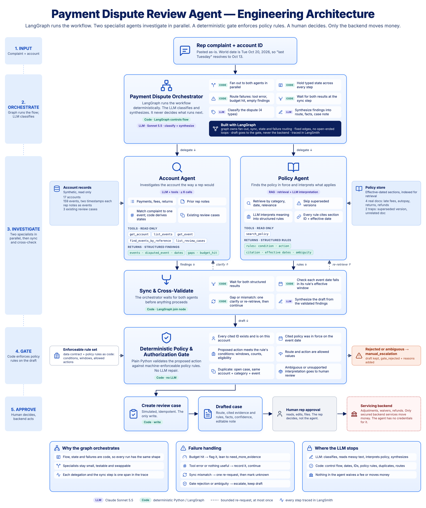
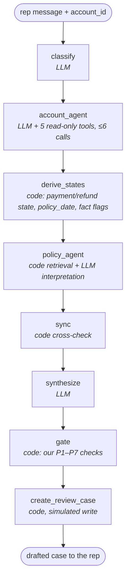

# Architecture

**v0.5.1 | October 25, 2026** | Built from [the brief](project_brief.md) v0.7 and [the data contract](data_contract.md) v1.2. Brief v0.7 matches this document.

> **v0.5:** The two agents now run **in sequence**, Account then Policy, because policy retrieval needs the disputed event's date and only the Account Agent knows it (D0). With the date known before retrieval, sync's re-requests have nothing left to fix, so they are gone and sync is a code-only cross-check. The gate's policy rules are now **our own Python checks for P1–P7**, keyed by policy section ID. The LLM's structured rules are advisory: they feed citations, the case note and the ambiguity flag, never the gate's logic (D7). **Ambiguity is split:** unclear policy goes to `manual_escalation`; unclear or missing facts go to `need_more_evidence` (D9). The route is the action; there is no separate action field (D8). D0 and D2 revised, D7–D9 added. Brief updated to v0.7.
>
> **v0.4:** LangGraph, not the LLM, controls the workflow; the LLM only classifies and synthesizes. Policy Agent became RAG returning structured rules with citations and effective dates. v0.3 closed all open decisions; v0.2 changed the shape from a flat pipeline to an orchestrator with two specialist agents.

---

## In one paragraph

A rep pastes a customer's complaint and the account ID. The **orchestrator** is a LangGraph graph with fixed edges: code, not the LLM, decides what runs next. It uses the LLM for two jobs only, naming the dispute type and synthesizing the findings into a draft. The **Account Agent** runs first: it investigates the account and proposes the disputed event, and code derives the payment and refund states from that event's chain. The **Policy Agent** runs second, because it needs that event's date: code retrieves the policy sections in force on that date, and one LLM call turns them into structured rules with citations. A **sync step** in code confirms the two sets of findings line up and marks anything missing as unknown. A **deterministic gate** in plain Python then runs our own checks for each cited policy section against the account's events. If the route contradicts a check, or the policy reading is ambiguous, the route is forced to `manual_escalation`. The agent's only write creates a simulated review case. A **human rep** reads the draft and decides. Adjustments, waivers and refunds happen in the **servicing backend**, which the agent cannot reach.

The analogy: a **kitchen ticket system** (LangGraph) that decides the order of work, a **head chef** (the LLM) who only names the dish and plates it, two **line cooks** (the agents) working in order because the second needs the first one's prep, the **pass** (the sync step) where both plates are checked before plating, a **health inspector** who checks every plate against the house rulebook rather than the chef's notes (the gate), and a **customer** who decides whether to eat it (the rep). The kitchen never handles the cash register.

---

## The five layers

| # | Layer | Who | Does |
|---|---|---|---|
| 1 | **Input** | Rep | Pastes the complaint; the account ID comes from the rep's screen, never guessed |
| 2 | **Orchestrate** | LangGraph (code), LLM for two calls | Code: fixed order, hold state, route failures, sync. LLM: classify, synthesize the draft |
| 3 | **Investigate** | LLM + tools, two agents in sequence, then a code sync step | Account Agent reads records and notes and finds the disputed event; Policy Agent retrieves and interprets the rules in force on that event's date; sync cross-checks |
| 4 | **Gate** | Code | Runs our Python policy checks, IDs, dates and duplicates against the draft; policy ambiguity escalates |
| 5 | **Approve** | Human, then backend | The rep decides; only the secured backend moves money |

## The graph

Every node runs once, in this order, on every run. Failures are written to state, not branched on, so the graph has no conditional edges. The one decision that overrides the LLM, forcing `manual_escalation`, happens inside the gate and is recorded in `gate_rejected`.

---

## 2. Payment Dispute Orchestrator — LangGraph, with two LLM calls

**The graph owns the run.** Workflow order, state and failure handling are deterministic code in LangGraph. The LLM never decides what runs next. It is called for exactly two things: classifying the dispute and synthesizing the agents' findings.

| Responsibility | Owner | How |
|---|---|---|
| **Classify** | LLM | One call picks one of `late_fee_autopay`, `missing_payment`, `returned_reversed_payment`, `refund_status` |
| **Delegate** | Code | Sends the account to the Account Agent first. Then sends the category and `policy_date` to the Policy Agent |
| **Track state** | Code | One typed state object; each step adds its own fields (see Graph state below) |
| **Handle failures** | Code | A budget hit, the exact text of a tool error, or "found nothing useful" is recorded in state and the run continues; that finding counts as unknown (D4, D5) |
| **Sync** | Code | Cross-checks both agents' findings before synthesis. See 3c |
| **Synthesize** | LLM | One call with structured output, after sync: route, cited events and policy sections, facts, confidence, open questions, case note |
| **Hand off** | Code | The draft goes to the gate. The orchestrator never calls the backend |

**Fixed delegation order.** The graph always runs the Account Agent, then the Policy Agent, once each, then sync, then synthesis. Nothing decides at runtime which agents to call, and nothing is asked twice. The precise claim is that the **outer graph shape is fixed**: inside the Account Agent the LLM does choose its own tool calls, from one to six. This is what keeps traces comparable across runs. Decided Oct 24 (D0), revised Oct 25 (v0.4, then v0.5).

**Why in sequence and not in parallel.** The Policy Agent filters by the effective date of the disputed event, and only the Account Agent produces that event. In parallel, the Policy Agent had to guess a date and sync had to repair the guess with a re-request. In sequence, the date is known before retrieval, so the mismatch cannot happen. The cost is a few seconds of latency on a case a human reads later.

## 3a. Account Agent — LLM with read-only tools, max 6 calls

**Investigates the account the way a rep would.** Payments, fees, returns, reversals, refunds and prior rep notes, with two timestamps per event so out-of-order cases are decidable.

| Tool | Returns | Notes |
|---|---|---|
| `get_account` | The account row, including `memo` | The memo can hold an injection trap (A-1004) |
| `list_events` | Events on this account | Both timestamps, the link to the earlier event, memo |
| `get_event` | One event by ID | |
| `find_events_by_reference` | Events whose reference matches, including partial matches, **across all accounts**, each tagged with its account ID (D1) | The gate still rejects citing another account's event |
| `list_review_cases` | Existing cases on this account | Feeds the duplicate check |

**Returns to the orchestrator, as structured findings:** the events it found with both dates; the disputed event it thinks the complaint is about, or **all candidates** if more than one fits and the complaint doesn't say which; any reference matches on other accounts; what it couldn't find; and a budget-hit flag if it ran out of tool calls (D4).

**Then code, before the Policy Agent runs:**

| Step | How |
|---|---|
| Confirm the disputed event | It must exist and be on this account; otherwise it is recorded as unknown |
| Derive states | `payment_state` and `refund_state` from the disputed event's chain (D3) |
| Set `policy_date` | The disputed event's `occurred_at`. If there is no single disputed event, the complaint date (Oct 20, 2026), with `policy_date_basis` recording which |
| Set fact flags | `fact_gap` (the disputed event or claimed record isn't on this account), `fact_ambiguous` (more than one candidate), `other_account_match` (a reference match on another account) |

**Can go wrong:** matching "the payment from Tuesday" to the wrong event; missing a rep note; trusting injected text in a memo.

## 3b. Policy Agent — RAG: retrieval plus LLM interpretation

**Finds the policy in force on `policy_date`, works out what it says about this case, and returns it as structured rules.**

| Step | Owner | How |
|---|---|---|
| **Retrieve** | Code | `search_policy` filters sections by category and `policy_date`, BM25-ranks the complaint-only query, keeps the top 10, then follows one-hop cross-references (D2) |
| **Interpret** | LLM | One call reads the retrieved sections and turns each relevant one into a structured rule |
| **Cite** | LLM, code checks | Every rule carries its section ID; dates stay in the retrieved store and are looked up by code |

| Tool | Returns | Notes |
|---|---|---|
| `search_policy` | Ranked policy sections for the category that were in force on `policy_date` | Filter first, then rank. Embeddings don't understand dates, so the date filter always runs first |

**Each structured rule has:** the condition it applies to, a five-value outcome (`fee_adjustment_review`, `refer_to_supervisor`, `ask_customer`, `explains_outcome`, or `procedural`), its citation, and a **policy-ambiguity** flag with a reason when the policy text doesn't clearly settle the case.

**The rules are advisory.** They feed the citations, the case note and the policy-ambiguity flag. The gate does not evaluate them; it runs its own checks (section 4, D7).

**The ambiguity flag covers the policy text only.** Not knowing which event the customer means is a fact question. The Account Agent reports it, and it routes to `need_more_evidence` (D9).

**Why effective dates matter:** there's a superseded late-fee policy with an older timeline. Citing it is a failure even though the text looks right.

**Returns to the orchestrator:** the structured rules and the section IDs they cite.

## 3c. Sync & cross-validate — code, a LangGraph node

**Both agents' findings are checked together before synthesis.** Neither result reaches synthesis unchecked.

| Check | On failure |
|---|---|
| Both structured results are present | A missing result is recorded as unknown (D5) |
| Each cited rule's effective window contains `policy_date` | That rule is recorded as unknown. Retrieval already filters on the same date, so a failure here is a bug and shows in the trace |
| The rules cover the dispute category | Recorded as unknown; synthesis leans to `manual_escalation` |

**No re-requests.** Nothing is asked again. Anything that doesn't line up is marked unknown and the run continues to synthesis, which leans to `need_more_evidence` or `manual_escalation`.

**Then the LLM synthesizes** the draft from the validated findings and the fact flags. The route rules it is given, which the evals also check:

| Situation | Route |
|---|---|
| A note conflicts with the records or the customer; evidence points at another account; policy is unclear | `manual_escalation` |
| The disputed event or claimed record is missing, or more than one candidate fits and the complaint doesn't say which | `need_more_evidence`, with `open_questions` naming what is needed |
| Records and policy suggest the customer may be right | `adjustment_review` |
| Records and policy explain what happened | `explain_events` |

**The route is the action.** The agent proposes nothing beyond which human queue gets the case, so there is no separate action field (D8).

## 4. Deterministic Policy & Authorization Gate — code, no LLM

**The rule set is ours, not the LLM's.** Policy assumptions P1–P7 (see [data/README.md](../data/README.md)) are written as Python checks, each keyed by the policy section ID that states it. The mapping from checks to section IDs is in [data/policies/README.md](../data/policies/README.md). The gate takes only the cited section IDs from the draft, never the LLM's interpretation of them (D7).

Each check reads structured event fields only (type, timestamps, amounts, links), never memo or note text. It returns `true`, `false` or `unknown`, where `unknown` means the evidence lives only in a note or the check doesn't apply. Only `true` rules a route out. `need_more_evidence` and `manual_escalation` are never ruled out.

| Check | Policy | Computed from the events | If true, rules out | Scenarios |
|---|---|---|---|---|
| `late_fee_unwarranted` | P1–P3 | A late fee was assessed, yet a payment was received (`occurred_at`) by 23:59 on due_day + 10 | `explain_events` | S-02 |
| `lender_side_failure` | P5 | The disputed chain shows an autopay draft that never ran while autopay was on, a received payment that never posted, or a payment received in grace but posted after the fee | `explain_events` | S-02, S-04, S-05 |
| `customer_cancelled_autopay` | P6 | Autopay was cancelled before the due date and no payment was received in grace | `adjustment_review` | S-01, S-03 |
| `return_fee_valid` | P4 | The $15 fee follows a posted return | `adjustment_review` | S-09, S-11, S-12 |
| `refund_overdue` | P7 | A refund was requested more than 10 business days before Oct 20 with no `refund_issued` linked | `explain_events` | S-13 |

S-10's keying error is recorded only in an ops note, so `lender_side_failure` returns `unknown` there and the LLM has to read the note. This is the note-driven case the code-only baseline should miss.

Checks, in order:

1. Every cited event and policy ID **exists and belongs to this account**.
2. The cited policy section was **in force on `policy_date`**.
3. **Our check for each cited section agrees with the route:** no `true` result rules out the chosen route.
4. The route is an **allowed value**.
5. **Duplicate rule:** an `open` case with the same account, category and disputed event means no new case.

**Policy ambiguity goes to a human.** If a cited rule carries the policy-ambiguity flag, or a cited section is not in the gate's registry (every current section is registered to a check or marked procedural; see [data/policies/README.md](../data/policies/README.md)), the gate does not guess. It routes to `manual_escalation` with the reason. **Fact ambiguity is not the gate's to escalate:** `need_more_evidence` is the right route for it, and the gate leaves that alone (D9, S-15).

**On rejection:** the route becomes `manual_escalation`, the output keeps the LLM's original citations and note, and `gate_rejected: true` is added with the reasons (D6). The LLM is not asked to try again. The flag lets the evals tell "the agent escalated correctly" from "the gate rescued it".

**Why code and not the LLM:** these are yes/no rules with right answers. The LLM interprets the policy text; code enforces the result. An LLM would sometimes get them wrong, and injected memo text could talk it out of them. Checking the LLM against rules the same LLM wrote would enforce its misreadings faithfully, so the gate's rules are written by us.

## 5. Approve — human, then backend

| Step | Who | What |
|---|---|---|
| **Create review case** | Code | Simulated and idempotent. If an open duplicate exists, it returns that case and creates nothing. Tests in the data: C-001 is closed, so it must not block S-05; C-002 is open, so it must block S-11; C-003 is open in a different category, so it must not block S-13 |
| **Drafted case** | Agent output | Route, cited evidence and rules, facts, confidence, open questions, editable 3–5 sentence note |
| **Human rep approval** | Rep | Reads, edits, files. The rep decides, not the agent |
| **Servicing backend** | Secured services | Adjustments, waivers, refunds. The agent has no credentials for it, so it cannot move money even if every other layer fails |

---

## Who owns each output field

The design rule: **language goes to the LLM, rules and control flow go to code.** Every field has one owner.

| Output field | Owner | Where |
|---|---|---|
| `category` | LLM | Orchestrator, classify |
| `policy_rules` | LLM, advisory | Policy Agent; sync checks dates; the gate runs its own checks instead |
| `event_ids`, `policy_source_ids` | LLM picks, code checks | Agents cite; gate rejects anything off-account or out of date |
| `facts.disputed_event_id` | LLM proposes, code confirms | Account Agent proposes; code confirms it exists and is on this account |
| `facts.payment_state`, `facts.refund_state` | Code | Derived from the disputed event's chain (D3) |
| `review_route` | LLM, code can override | Orchestrator synthesize; gate forces `manual_escalation` on rejection or policy ambiguity |
| `confidence`, `open_questions`, `case_note` | LLM | Orchestrator synthesize |
| `case_id` | Code | Create review case |
| `gate_rejected`, `gate_reasons` | Code | Gate (D6) |

## Graph state

One object travels through the graph. Each step reads it and adds its own fields.

| Field | Written by |
|---|---|
| `rep_message`, `account_id` | Input |
| `category` | Orchestrator, classify |
| `account_findings` (events, proposed disputed event or candidates, other-account matches, tool call count, budget-hit flag, exact error text) | Account Agent |
| `derived_states` (`payment_state`, `refund_state`) | Code, after the Account Agent |
| `policy_date`, `policy_date_basis` | Code, after the Account Agent |
| `fact_flags` (`fact_gap`, `fact_ambiguous`, `other_account_match`) | Code, after the Account Agent |
| `policy_findings` (advisory structured rules with condition, what it allows, citation, effective dates, policy-ambiguity flag; exact error text or "nothing useful") | Policy Agent |
| `sync_issues` (what didn't line up, marked unknown) | Sync |
| `draft` (the full agent output) | Orchestrator, synthesize |
| `check_results` (per cited section: `true`, `false` or `unknown`, and routes ruled out) | Gate |
| `gate_rejected`, `gate_reasons` | Gate |
| `case_id`, `created` | Create review case |

---

## How each trap is defended

The answer to "why should a rep trust it?"

| Trap | Scenarios | First defense | Backstop |
|---|---|---|---|
| `injection` | S-04, S-14 | Memo text is wrapped in labeled delimiters and the Account Agent prompt says it is data, not instructions | The gate's checks never read memo text. In S-04, `lender_side_failure` rules out the `explain_events` route the memo pushes. Evaluators catch the rest |
| `wrong_account` | S-07 | Reference lookup shows each result's account; `other_account_match` routes to `manual_escalation` | Gate rejects off-account citations, so the route escalates |
| `duplicate` | S-11 | `list_review_cases` | Create review case is idempotent |
| `out_of_order` | S-02 | Two timestamps per event; lateness judged by `occurred_at` | `late_fee_unwarranted` (P1–P3) rules out `explain_events` |
| `missing_record` | S-06, S-16 | `fact_gap` leads to `need_more_evidence` plus `open_questions` | Gate rejects citing S-06's look-alike on A-1009; forbidden-event check in evals |
| `ambiguous` | S-15 | Account Agent returns both refund requests as candidates; `fact_ambiguous` leads to `need_more_evidence` | The gate escalates only policy ambiguity, so it leaves this route alone (D9); confidence-consistency check in evals |
| `stale_policy` | passive | Code filters policy by `policy_date` before ranking | Sync and gate check the cited section's dates; evals require the current section ID |
| Note conflicts with records or customer | S-03, S-12, S-13 | Rep notes are events the Account Agent reads | Route rule: a conflict means escalation. In S-13, `refund_overdue` rules out `explain_events` |

---

## Models and observability

- **Claude Sonnet 5.5** makes the orchestrator's two LLM calls, classify and synthesize, and runs both agents. LangGraph, not a model, runs the workflow.
- **Claude Opus 5.5** judges case notes in evals, so the agent isn't graded by the model that wrote the answer.
- **LangSmith** traces every span. The orchestrator is the parent run; each agent delegation, the sync step and the gate are children, so a failure is traceable to the step that caused it. Runs are tagged with scenario ID, category, trap, wording and note_driven.

---

## Decisions

All decided by Rachit. D0 on Oct 24, 2026; D1–D6 on Oct 25, 2026; D0 and D2 revised Oct 25 (v0.4 and v0.5); D7–D9 on Oct 25 (v0.5). Each row records the alternative that was not chosen, for the interview.

| # | Decision | Chosen | Not chosen | Why |
|---|---|---|---|---|
| **D0** | Orchestrator delegation order | **Fixed and sequential, in LangGraph.** Account Agent, then Policy Agent, once each, then sync, then synthesize. No re-requests | Parallel fan-out with a sync re-request (v0.4); LLM chooses which agents to call, or loops until satisfied | Policy retrieval needs the disputed event's date, which only the Account Agent produces. Parallel meant guessing the date and repairing the guess. In sequence, every trace has the same outer shape and the latency cost is a few seconds |
| **D1** | Does `find_events_by_reference` search across accounts? | **Yes, with each result tagged by account** | This account only; or account ID only | Otherwise the S-07 payment keyed to A-1008 can never be found and the wrong-account trap tests nothing |
| **D2** | Policy retrieval method | **RAG. Code filter by category and `policy_date`, then relevance ranking; one LLM call interprets the sections into advisory structured rules with citations and effective dates.** Vector ranking is a drop-in on Day 2 if time allows | Filter plus free-text rule extraction (v0.3); vector search alone | The date filter always runs first, since embeddings don't understand dates. Revised v0.5: the date comes from the Account Agent, and the rules are advisory (D7) |
| **D3** | Who sets `payment_state` and `refund_state` | **Account Agent picks the disputed event; code derives both states from its event chain** | LLM sets everything; or both with a gate check | Rules go to code. Removes a class of LLM error. Evals measure a bit less of the LLM |
| **D4** | Account Agent hits 6 tool calls | **Stop, return findings, set a budget-hit flag** the orchestrator carries into synthesis, leaning to `need_more_evidence` | Stop silently; force escalation | A capped run must not look like a confident run |
| **D5** | Tool error or empty findings | **Record the exact error text, or "found nothing useful", in state; mark that finding unknown; continue to sync.** No retry of a failed tool call in v1 | Retry once; abort and escalate | Visible failures produce the right route and show in the trace. A retry would change trace shape |
| **D6** | Output after a gate rejection | **Keep the original citations and note; add `gate_rejected: true` and the reasons** | Strip bad citations; minimal escalation only | Lets evals tell "agent escalated correctly" from "gate rescued it" (S-07). Keeps evidence for the failure write-up |
| **D7** | Where the gate's policy rules come from | **Our own Python checks for P1–P7, keyed by policy section ID. They read structured event fields only and return true, false or unknown** | The gate evaluates the LLM's structured rules (v0.4) | Otherwise the gate checks the LLM against rules the same LLM wrote, and a misreading is enforced faithfully. It also avoids building a rule language for LLM-written conditions |
| **D8** | What the agent proposes | **Only a route. The route is the action** | A separate `proposed_action` field | The agent's only power is choosing which human queue gets the case. One field to check |
| **D9** | Where ambiguity goes | **Split. Unclear policy goes to `manual_escalation`; unclear or missing facts go to `need_more_evidence` with open questions** | All ambiguity goes to `manual_escalation` (v0.4) | A missing fact is for the customer to supply; an unclear policy needs someone with authority. v0.4 would have sent S-15 to the wrong route |

## Deliberately not in v1

- **No parallel fan-out, no runtime agent selection, no re-requests and no retry loops.** A tool error is recorded and the run continues (D5).
- **No third agent.** Classification and synthesis stay inside the orchestrator as one LLM call each; sync and the gate are code nodes, not agents.
- **No UI, streaming, authentication or real integrations.**
- **No real money, customers or policy.**
