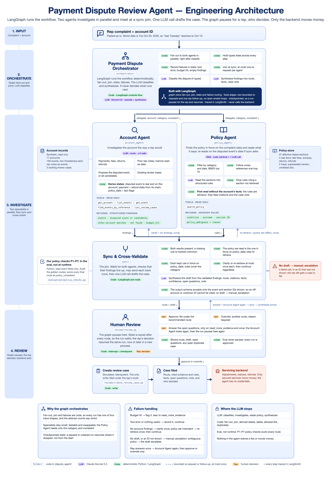
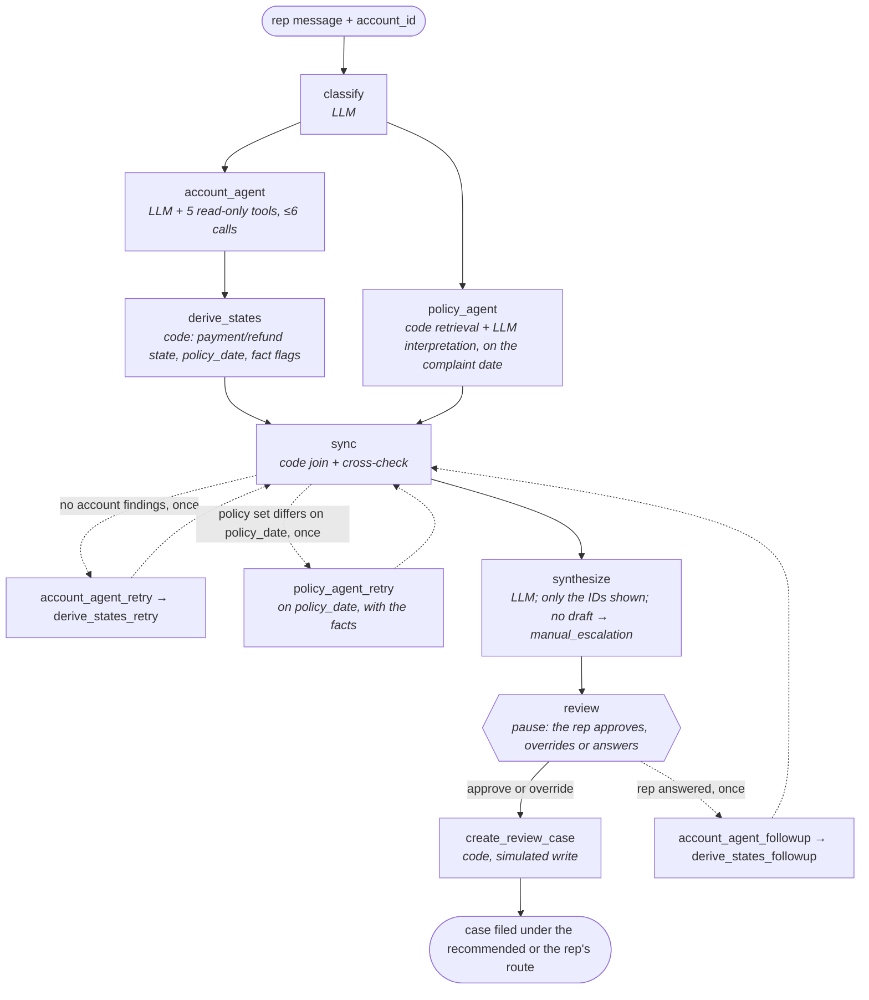

# Architecture

**v0.8 | October 27, 2026** | Built from [the brief](project_brief.md) v0.10 and [the data contract](data_contract.md) v1.2. Brief v0.10 matches this document.

---

## In one paragraph

A rep pastes a customer's complaint and the account ID. The **orchestrator** is a LangGraph graph: code, not the LLM, decides what runs next. It uses the LLM for two jobs of its own, naming the dispute type and synthesizing the findings into a draft, and sends two specialist agents out **in parallel**. The **Account Agent** investigates the account and proposes the disputed event, and code derives the payment and refund states from that event's chain. The **Policy Agent** retrieves the policy sections in force on the complaint date, and one LLM call turns them into structured rules with citations. A **sync step** in code is the join where both agents report back: it confirms the two sets of findings line up, marks anything missing as unknown, and can send each agent back once, the Account Agent if it returned nothing and the Policy Agent if a different policy set was in force on the disputed event's date. One LLM call then **synthesizes** the draft: route, cited events and sections, facts, confidence, open questions and a case note. Its output schema accepts only the event and section IDs it was shown, so an off-account or unshown ID cannot be cited, and if no draft comes back the route falls back to `manual_escalation`. The graph then **pauses for a human rep**, who approves the route, overrides it with a reason, or, when the route is `need_more_evidence`, answers the open questions once so the Account Agent can look again. Only then does the agent's one write create a simulated review case. Adjustments, waivers and refunds happen in the **servicing backend**, which the agent cannot reach. Our own **policy checks for P1–P7** run in the eval, not at runtime: they score every route the agent recommends and audit the golden labels.

The analogy: a **kitchen ticket system** (LangGraph) that decides the order of work, a **head chef** (the LLM) who only names the dish and plates it, two **line cooks** (the agents) working at the same time on their own stations, the **pass** (the sync step) where both plates are checked together and a plate can be sent back once, and a **customer** who decides whether to eat it (the rep). A **food critic** scores every plate afterwards against the house rulebook rather than the chef's notes (the eval's P1–P7 checks). The kitchen never handles the cash register.

---

## The four layers

| # | Layer | Who | Does |
|---|---|---|---|
| 1 | **Input** | Rep | Pastes the complaint; the account ID comes from the rep's screen, never guessed |
| 2 | **Orchestrate** | LangGraph (code), LLM for two calls | Code: fan out to both agents, hold state, route failures, sync, the two bounded re-requests. LLM: classify, synthesize the draft |
| 3 | **Investigate** | LLM + tools, two agents in parallel, then a code sync join | Account Agent reads records and notes and finds the disputed event; Policy Agent retrieves and interprets the rules in force on the complaint date; sync cross-checks both and re-requests at most once each |
| 4 | **Review** | Human, inside the graph; then the backend | The graph pauses; the rep approves, overrides or answers once; the case is filed. Only the secured backend moves money |

## The graph

After classify, the two agents run in parallel and meet at sync, a join node. Sync holds the graph's one routing decision: it can send the Account Agent back once (no findings) and the Policy Agent back once (a different policy set was in force on the disputed event's date), the dashed edges; then the run always continues. Every other failure is written to state, not branched on. Nothing overrides the LLM's route at runtime: it is the draft's route, or `manual_escalation` when synthesize returns no draft. After synthesize the graph **pauses at `review`** for the rep (section 4); the graph's second routing decision, `after_review`, files the case or, when the rep answered, sends the Account Agent back once through its own follow-up nodes. Built as a `StateGraph` in [pipeline.py](../dispute_agent/orchestrator/graph.py), compiled with a checkpointer so a paused run can be resumed later; each `invoke` is one parent trace.

---

## 2. Payment Dispute Orchestrator — LangGraph, with two LLM calls

Code: [`dispute_agent/orchestrator/`](../dispute_agent/orchestrator/)

**The graph owns the run.** Workflow order, state and failure handling are deterministic code in LangGraph. The LLM never decides what runs next. It is called for exactly two things: classifying the dispute and synthesizing the agents' findings.

| Responsibility | Owner | How |
|---|---|---|
| **Classify** | LLM | One call picks one of `late_fee_autopay`, `missing_payment`, `returned_reversed_payment`, `refund_status` |
| **Delegate** | Code | Fans out: the account, category and complaint go to the Account Agent, the category and complaint to the Policy Agent, at the same time |
| **Track state** | Code | One typed state object; each step adds its own fields (see Graph state below) |
| **Handle failures** | Code | A budget hit, the exact text of a tool error, or "found nothing useful" is recorded in state and the run continues; that finding counts as unknown (D4, D5) |
| **Sync** | Code | Joins both agents' findings, cross-checks them, and may send each agent back once. See 3c |
| **Synthesize** | LLM | One call with structured output, after sync: route, cited events and policy sections, facts, confidence, open questions, case note |
| **Hand off** | Code | The draft and its recommended route go to the review pause (section 4). The orchestrator never calls the backend |

**Fixed graph shape.** The graph always runs classify, both agents in parallel, sync, synthesis, the review pause and the write. Nothing decides at runtime which agents to call. Sync may add at most one more run of each agent, by code rules (3c), so the first parent run has one of four shapes, ending at the `review` pause, and the two attempt counts say which. A rep's answer adds a resume run of one of two shapes (with or without a re-retrieve); approve and override resumes run only `review` and `create_review_case`. The precise claim is that the **outer graph shape is fixed**: inside the Account Agent the LLM does choose its own tool calls, from one to six. Decided Oct 24 (D0), revised Oct 25 (v0.4, then v0.5), Oct 26 (v0.6, back to the v0.4 shape) and Oct 27 (v0.8, one node fewer: D10).

**Why in parallel.** The two investigations are independent until sync: the Policy Agent needs only the category and the complaint, both known after classify. Reading the policy on the complaint date is right whenever the same policy set was in force on the disputed event's date, which sync checks in code once that date is known; when it was not, one re-retrieve on the right date fixes it (3c). The cost is a first policy read without the account's facts; the rules are advisory, so that read shapes only the citations and the case note.

## 3a. Account Agent — LLM with read-only tools, max 6 calls

Code: [`dispute_agent/account_agent/`](../dispute_agent/account_agent/)

**Investigates the account the way a rep would.** Payments, fees, returns, reversals, refunds and prior rep notes, with two timestamps per event so out-of-order cases are decidable.

| Tool | Returns | Notes |
|---|---|---|
| `get_account` | The account row, including `memo` | The memo can hold an injection trap (A-1004) |
| `list_events` | Events on this account | Both timestamps, the link to the earlier event, memo |
| `get_event` | One event by ID | |
| `find_events_by_reference` | Events whose reference matches, including partial matches, **across all accounts**, each tagged with its account ID (D1) | The draft still cannot cite another account's event: `derive_states` drops it and the draft schema accepts only shown IDs |
| `list_review_cases` | Existing cases on this account | Feeds the duplicate check |

**Returns to the orchestrator, as structured findings:** the events it found with both dates; the disputed event it thinks the complaint is about, or **all candidates** if more than one fits and the complaint doesn't say which; any reference matches on other accounts; what it couldn't find; and a budget-hit flag if it ran out of tool calls (D4).

**Then code, in `derive_states`:**

| Step | How |
|---|---|
| Confirm the disputed event | It must exist and be on this account; otherwise it is recorded as unknown |
| Derive states | `payment_state` and `refund_state` from the disputed event's chain (D3) |
| Set `policy_date` | The disputed event's `occurred_at`. If there is no single disputed event, the complaint date (Oct 20, 2026), with `policy_date_basis` recording which |
| Set fact flags | `fact_gap` (the disputed event or claimed record isn't on this account), `fact_ambiguous` (more than one candidate), `other_account_match` (a reference match on another account) |

**Can go wrong:** matching "the payment from Tuesday" to the wrong event; missing a rep note; trusting injected text in a memo.

## 3b. Policy Agent — RAG: retrieval plus LLM interpretation

Code: [`dispute_agent/policy_agent/`](../dispute_agent/policy_agent/)

**Finds the policy in force, works out what it says about this case, and returns it as structured rules.** It runs in parallel with the Account Agent, so its first read is on the complaint date (Oct 20, 2026) with no account facts; a re-retrieve (3c) reads on the disputed event's `policy_date` with the facts.

| Step | Owner | How |
|---|---|---|
| **Retrieve** | Code | `search_policy` filters sections by category and the read date, BM25-ranks the complaint-only query, keeps the top 10, then follows one-hop cross-references (D2) |
| **Interpret** | LLM | One call reads the retrieved sections and turns each relevant one into a structured rule |
| **Cite** | LLM, code checks | Every rule carries its section ID; dates stay in the retrieved store and are looked up by code |

| Tool | Returns | Notes |
|---|---|---|
| `search_policy` | Ranked policy sections for the category that were in force on the read date | Filter first, then rank. Embeddings don't understand dates, so the date filter always runs first |

**Each structured rule has:** the condition it applies to, a five-value outcome (`fee_adjustment_review`, `refer_to_supervisor`, `ask_customer`, `explains_outcome`, or `procedural`), its citation, and a **policy-ambiguity** flag with a reason when the policy text doesn't clearly settle the case.

**The rules are advisory.** They feed the citations, the case note and the policy-ambiguity flag. Nothing enforces them in code; the eval scores routes with our own P1–P7 checks instead (D7).

**The ambiguity flag covers the policy text only.** Not knowing which event the customer means is a fact question. The Account Agent reports it, and it routes to `need_more_evidence` (D9).

**Why effective dates matter:** there's a superseded late-fee policy with an older timeline. Citing it is a failure even though the text looks right.

**Returns to the orchestrator:** the structured rules and the section IDs they cite.

## 3c. Sync & cross-validate — code, the LangGraph join node

Code: [`dispute_agent/sync/`](../dispute_agent/sync/)

**Both agents' findings are checked together before synthesis.** Sync waits for both branches; neither result reaches synthesis unchecked.

| Check | On failure |
|---|---|
| Both structured results are present | A missing result is recorded as unknown (D5); no account findings triggers the clarify re-request |
| The policy set the Policy Agent read (in force on the complaint date) is the set in force on `policy_date` | `policy_date_mismatch`, which triggers the re-retrieve. Compared as sets of section IDs, so a different date under the same policy costs nothing |
| Each kept rule's effective window contains `policy_date` | That rule is dropped and recorded as an issue. After a re-retrieve this cannot happen, so a drop here is a bug and shows in the trace |
| The rules cover the dispute category | Recorded as an issue; synthesis leans to `manual_escalation` |

**Two bounded re-requests, each at most once.** *Clarify:* if the Account Agent returned no findings at all (its finalize call failed), it and `derive_states` run once more; the Policy Agent is not rerun, it already ran in parallel. *Re-retrieve:* if a different policy set was in force on the disputed event's date than on the complaint date, the Policy Agent runs once more on `policy_date`, this time with the account's facts. Clarify goes first and re-retrieve on the next pass, so sync runs at most three times; then the run continues whatever the result. These are the two failures a second run can fix. Nothing else is asked again: a budget hit, missing policy, a dropped rule or a category mismatch would come back identical, so those are marked as issues and the run continues to synthesis. On the current data the re-retrieve never fires, since every disputed event is after LF.v3's May 1, 2026 start; an offline test covers it with an earlier date.

**Built as [sync.py](../dispute_agent/sync/sync.py).** `sync` is pure: it returns the kept rules, the dropped section IDs, five flags (`account_missing`, `policy_missing`, `policy_date_mismatch`, `budget_hit`, `category_covered`), the issues as sentences, and a `lean`: the cautious route the draft should lean to, chosen by the first failing flag in the order missing policy, category not covered, account missing, budget hit. The lean is a sentence in the prompt, never a route set by code. The re-requests are edges in [pipeline.py](../dispute_agent/orchestrator/graph.py) (`after_sync`, `MAX_ATTEMPTS = 2`) through dedicated `*_retry` nodes with plain edges back into sync, because re-entering the fan-out nodes would hit the join barrier and end the run silently. The run records `account_attempts` and `policy_attempts`.

**Then the LLM synthesizes** the draft from the validated findings and the fact flags. **Built as [synthesize.py](../dispute_agent/sync/synthesize.py):** code renders one message with the category, policy date and basis, the complaint, the Account Agent's summary and notes summary, the tool count and errors, the derived facts, the evidence events with memos inside delimiters, the Policy Agent's summary, the kept rules (section, outcome, ambiguity, condition, why) and the sync note with its lean; one Sonnet call with structured output returns the `Draft`. The output schema is built per call so `event_ids` and `policy_source_ids` accept only the IDs shown (the evidence events, already on this account, and the kept rules, already in force on `policy_date`); an unshown or off-account ID cannot be emitted. When nothing was shown a schema cannot say "no IDs", so `run_synthesize` rejects any ID itself. A failed call or a rejected ID becomes an error and no draft; `SynthesisResult.route`, the route the rep is asked to approve, is then `manual_escalation`, and otherwise the draft's route, unmodified. The route rules the LLM is given, which the evals also check:

| Situation | Route |
|---|---|
| A note conflicts with the records or the customer; evidence points at another account; policy is unclear | `manual_escalation` |
| The disputed event or claimed record is missing, or more than one candidate fits and the complaint doesn't say which | `need_more_evidence`, with `open_questions` naming what is needed |
| Records and policy suggest the customer may be right | `adjustment_review` |
| Records and policy explain what happened | `explain_events` |

**The route is the action.** The agent proposes nothing beyond which human queue gets the case, so there is no separate action field (D8).

## 4. Review — a human, inside the graph; then the backend

Code: [`dispute_agent/review/`](../dispute_agent/review/)

The graph **pauses** at the `review` node after synthesize. LangGraph saves the graph's state after every node (a *checkpointer*: a save-game file, `runs/checkpoints.sqlite` for the CLI); the pause (an *interrupt*) hands the caller a payload and later continues from the same save with the rep's answer, in the same process or a new one (`resume <thread>`). Code renders the payload and records the decision; no LLM runs in this node. Built in [review.py](../dispute_agent/review/review.py) and [pipeline.py](../dispute_agent/orchestrator/graph.py), planned in [plans/human-review.md](plans/human-review.md).

| Rep action | When | What happens |
|---|---|---|
| **approve** | Always | The case is filed under the recommended route |
| **override** | Always; needs a reason | The case is filed under the rep's route; the recommended route stays as synthesize wrote it (H8) |
| **answer** | Only when the route is `need_more_evidence` and no answer has been used | The answer is added to the complaint as `Rep follow-up (after review): ...`; the Account Agent runs again through `account_agent_followup` → `derive_states_followup` → sync → synthesize, and the graph pauses again. At most once (`MAX_FOLLOWUPS = 1`); the second pause offers approve or override only |

**Live example (Oct 26, S-15's account, thread `A-1016-20261027T030830Z`).** `ask A-1016 "where is my refund?? been weeks"` paused at `need_more_evidence` with the open question "Which refund is the customer asking about: the $25.00 late fee refund (E-0128) or the $731.50 duplicate September payment refund (E-0138)?". `resume ... --answer "customer means the $731.50 refund requested Oct 6"` ran the Account Agent again: it picked E-0138, `fact_ambiguous` turned false, sync found no issues (account attempts 2, policy attempts 1), and the new draft routed `explain_events`, because the Oct 6 request is still inside the 10-business-day refund window. The second pause offered approve or override only; `resume ... --approve` filed C-004 under `explain_events`. In LangSmith the thread has three parent runs: `dispute A-1016` (ends at `review`), the answer-path `dispute A-1016 resume` (then `review > account_agent_followup > derive_states_followup > sync > synthesize > review`, which v0.8 keeps minus one node) and a token-free approve resume.

The **eval never pauses**: `investigate()` approves every pause, so the scores measure the agents, not a person. A run that crashed mid-way (an API error) is also resumable: `ask` prints the thread ID first, and `resume <thread>` re-runs the failed node from its checkpoint. The decision given then is not used: a run that crashed before `review` pauses there again, and one that crashed in `create_review_case` files under the decision already made at the pause.

| Step | Who | What |
|---|---|---|
| **Create review case** | Code | Simulated and idempotent; built as [create_review_case.py](../dispute_agent/review/create_review_case.py). Runs after the review on every run, a missing draft included, and files the case under the final route: the rep's override, else the recommended route. `find_duplicate` looks for an open case with the same account, category and disputed event; the review pause shows it to the rep first, and filing returns that case and creates nothing. Tests in the data: C-001 is closed, so it must not block S-05; C-002 is open, so it must block S-11; C-003 is open in a different category, so it must not block S-13 |
| **Drafted case** | Agent output | Route, cited evidence and rules, facts, confidence, open questions, editable 3–5 sentence note |
| **Human rep review** | Rep, at the pause | Approves, overrides with a reason, or answers once. The rep decides, not the agent. Editing the note or the citations happens outside the agent |
| **Servicing backend** | Secured services | Adjustments, waivers, refunds. The agent has no credentials for it, so it cannot move money even if every other layer fails |

## Our P1–P7 policy checks — in the eval, not at runtime

Code: [`dispute_agent/evaluation/policy_checks.py`](../dispute_agent/evaluation/policy_checks.py)

**The rule set is ours, not the LLM's.** Policy assumptions P1–P7 (see [data/README.md](../data/README.md)) are written as five Python checks. Each reads structured event fields only (type, timestamps, amounts, links), never memo or note text, and returns `true`, `false` or `unknown`, where `unknown` means the evidence lives only in a note or the check doesn't apply. A `true` result rules out one route; `need_more_evidence` and `manual_escalation` are never ruled out (D7).

| Check | Policy | Computed from the events | If true, rules out | Scenarios |
|---|---|---|---|---|
| `late_fee_unwarranted` | P1–P3 | A late fee was assessed, yet a payment was received (`occurred_at`) by 23:59 on due_day + 10 | `explain_events` | S-02 |
| `lender_side_failure` | P5 | The disputed chain shows an autopay draft that never ran while autopay was on, a received payment that never posted, or a payment received in grace but posted after the fee | `explain_events` | S-02, S-04, S-05 |
| `customer_cancelled_autopay` | P6 | Autopay was cancelled before the due date and no payment was received in grace | `adjustment_review` | S-01, S-03 |
| `return_fee_valid` | P4 | The $15 fee follows a posted return | `adjustment_review` | S-09, S-11, S-12 |
| `refund_overdue` | P7 | The refund request in question was made more than 10 business days before Oct 20 with no `refund_issued` linked. With a disputed event, only requests in its chain count; without one (S-15), every request in the evidence counts | `explain_events` | S-13 |

S-10's keying error is recorded only in an ops note, so `lender_side_failure` returns `unknown` there and only the LLM can read it. This is the note-driven case the code-only baseline should miss, and the reason S-03, S-10 and S-14 can be routed wrong without any check noticing.

**Used twice, both in the eval:**

- **`policy_consistent`**, a check on every scored row: the final route is not ruled out by P1–P7 on the agent's own derived facts. It needs no golden answer, so it can also score live cases, where no answer key exists. It is part of the `guardrails` axis.
- **The golden audit**, `python -m dispute_agent.evaluation.policy_checks`: every scenario's answer key through P1–P7, failing if any expected route is ruled out. All 16 pass, so the hand-written labels agree with the rules written in code.

**Why not at runtime (D10).** Until v0.8 these checks ran in a gate node between synthesize and review that forced `manual_escalation` when a true check ruled out the draft's route, when a cited policy reading was flagged ambiguous, or when a cited ID was off-account, unknown or out of date. Across all 43 eval reports (279 scored rows) it rejected 8 drafts and never changed a route: each time the draft had already chosen `manual_escalation`, or there was no draft. What each of its jobs became:

| What that node did | Where it is done now |
|---|---|
| Cited events exist and are on this account | `derive_states` keeps only this account's events as evidence; the draft schema accepts only shown IDs |
| Cited sections were in force on `policy_date` | Retrieval filters by date, sync drops any rule not in force, and the schema accepts only the kept rules |
| P1–P7 agree with the route | The eval: `policy_consistent` on every row |
| Policy ambiguity escalates | Synthesize's route rule 1. The flag is itself an LLM output (the Policy Agent's) and was wrong 2 of the 3 times it fired (S-10, S-14), so code does not enforce it |
| No draft → `manual_escalation` | `SynthesisResult.route` |
| Duplicate open case | `find_duplicate` in `create_review_case.py`, shown at the review pause |

---

## Who owns each output field

The design rule: **language goes to the LLM, rules and control flow go to code.** Every field has one owner.

| Output field | Owner | Where |
|---|---|---|
| `category` | LLM | Orchestrator, classify |
| `policy_rules` | LLM, advisory | Policy Agent; sync checks dates; they feed citations and the case note |
| `event_ids`, `policy_source_ids` | LLM picks, code limits | Agents cite; the draft schema accepts only the evidence events (this account's) and the kept rules (in force) |
| `facts.disputed_event_id` | LLM proposes, code confirms | Account Agent proposes; code confirms it exists and is on this account |
| `facts.payment_state`, `facts.refund_state` | Code | Derived from the disputed event's chain (D3) |
| `review_route` | LLM; code falls back | Orchestrator synthesize; `SynthesisResult.route` is `manual_escalation` when there is no draft |
| `confidence`, `open_questions`, `case_note` | LLM | Orchestrator synthesize |
| `case_id` | Code | Create review case |
| `existing_case_id` | Code | `find_duplicate`: shown at the review pause, used when the case is filed |
| Final route on the case | Rep, code records | The recommended route, unless the rep overrode it at `review` (H8) |
| `policy_consistent` | Code, eval only | P1–P7 in `evaluation/policy_checks.py` (D7, D10) |

## Graph state

One object travels through the graph. Each step reads it and adds its own fields.

| Field | Written by |
|---|---|
| `rep_message`, `account_id` | Input |
| `category` | Orchestrator, classify |
| `account_findings` (events, proposed disputed event or candidates, other-account matches, tool call count, budget-hit flag, exact error text) | Account Agent |
| `derived_states` (`payment_state`, `refund_state`) | Code, after the Account Agent |
| `policy_date`, `policy_date_basis` | Code, after the Account Agent |
| `fact_flags` (`fact_gap`, `fact_ambiguous`, `other_account_match`) | Code, after the Account Agent |
| `policy_findings` (advisory structured rules with condition, what it allows, citation, effective dates, policy-ambiguity flag; the read date and its basis; exact error text or "nothing useful") | Policy Agent |
| `sync` (kept rules, dropped sections, the five flags, issues, lean), `account_attempts` and `policy_attempts` (1, or 2 after a re-request) | Sync |
| `synthesis`: the `draft` (route, cited events and sections, confidence, open questions, case note) or the synthesize error, and `route`, the recommended route (the draft's, or `manual_escalation`) | Orchestrator, synthesize |
| `thread_label`, `review` (the rep's last decision: approve, override with route and reason, or answer), `followups` (0 or 1), `rep_answer` | Input; the `review` node; the follow-up node |
| `case` (`case_id`, `created`, account, category, disputed event, final route) | Create review case |

---

## How each trap is defended

The answer to "why should a rep trust it?"

| Trap | Scenarios | First defense | Backstop |
|---|---|---|---|
| `injection` | S-04, S-14 | Memo text is wrapped in labeled delimiters and the Account Agent prompt says it is data, not instructions | Our P1–P7 checks never read memo text: in S-04, `lender_side_failure` rules out the `explain_events` route the memo pushes, and the eval's `policy_consistent` check catches it. Evaluators catch the rest |
| `wrong_account` | S-07 | Reference lookup shows each result's account; `other_account_match` routes to `manual_escalation` | The draft schema only allows this account's shown events, so E-0135 cannot be cited; a draft that tries is rejected and the route falls back to `manual_escalation` |
| `duplicate` | S-11 | `list_review_cases` | Create review case is idempotent |
| `out_of_order` | S-02 | Two timestamps per event; lateness judged by `occurred_at` | `late_fee_unwarranted` (P1–P3) rules out `explain_events`, scored as `policy_consistent` |
| `missing_record` | S-06, S-16 | `fact_gap` leads to `need_more_evidence` plus `open_questions` | S-06's look-alike on A-1009 is never shown, so the draft cannot cite it; forbidden-event check in evals |
| `ambiguous` | S-15 | Account Agent returns both refund requests as candidates; `fact_ambiguous` leads to `need_more_evidence` | Route rules split ambiguity: unclear facts are `need_more_evidence`, unclear policy is `manual_escalation` (D9); confidence-consistency check in evals |
| `stale_policy` | passive | Code filters policy by `policy_date` before ranking | Sync drops any rule not in force on `policy_date`, so the draft cannot cite it; evals require the current section ID |
| Note conflicts with records or customer | S-03, S-12, S-13 | Rep notes are events the Account Agent reads | Route rule: a conflict means escalation. In S-13, `refund_overdue` rules out `explain_events` (`policy_consistent`) |

---

## Models and observability

`python -m dispute_agent trace` checks recent LangSmith graph shapes against the recorded attempt counts. The
validation-only `DISPUTE_FAULT` switch can exercise each bounded re-request path without changing normal runs.

- **Claude Sonnet 5.5** makes the orchestrator's two LLM calls, classify and synthesize, and runs both agents. LangGraph, not a model, runs the workflow.
- **Claude Opus 5.5** judges case notes in evals, so the agent isn't graded by the model that wrote the answer.
- **LangSmith** traces every span. Each `invoke` is one parent run: `dispute <label>` up to the pause, then `dispute <label> resume` for each resume, all on one `thread_id`. Approve and override resumes make no model calls. Within a parent run every node (classify, both agents, derive, sync, any retry or follow-up, synthesize, review, create_review_case) is a child, so a failure is traceable to the step that caused it and the trace's shape shows whether a re-request fired. Runs are tagged with scenario ID, category, trap, wording and note_driven.

---

## Decisions

All decided by Rachit. D0 on Oct 24, 2026; D1–D6 on Oct 25, 2026; D0 and D2 revised Oct 25 (v0.4 and v0.5); D7–D9 on Oct 25 (v0.5); D0, D2 and D5 revised Oct 26 (v0.6, back to the v0.4 shape); D10 on Oct 27 (v0.8), which supersedes D6 and revises D7. Each row records the alternative that was not chosen, for the interview.

| # | Decision | Chosen | Not chosen | Why |
|---|---|---|---|---|
| **D0** | Orchestrator delegation order | **Fixed fan-out in LangGraph: both agents in parallel, then sync, then synthesize.** Sync may send each agent back once, by code rules: the Account Agent on no findings, the Policy Agent on a policy-set mismatch (revised Oct 26, v0.6) | Sequential, Account then Policy (v0.5); an LLM supervisor that chooses which agents to call, or loops until satisfied | Rachit wants a multi-agent system in the v0.4 sense: two specialists under one orchestrator, meeting at a join. In parallel the outer shape is still fixed and code still routes. The first policy read lacks the account's facts, which is acceptable because the rules are advisory (D7), and the one case where the date matters is repaired by the re-retrieve |
| **D1** | Does `find_events_by_reference` search across accounts? | **Yes, with each result tagged by account** | This account only; or account ID only | Otherwise the S-07 payment keyed to A-1008 can never be found and the wrong-account trap tests nothing |
| **D2** | Policy retrieval method | **RAG. Code filter by category and `policy_date`, then relevance ranking; one LLM call interprets the sections into advisory structured rules with citations and effective dates.** Vector ranking is a drop-in on Day 2 if time allows | Filter plus free-text rule extraction (v0.3); vector search alone | The date filter always runs first, since embeddings don't understand dates. Revised v0.6: the first read is on the complaint date; a re-retrieve reads on the disputed event's date with the facts. The rules are advisory (D7) |
| **D3** | Who sets `payment_state` and `refund_state` | **Account Agent picks the disputed event; code derives both states from its event chain** | LLM sets everything; or both, checked by code afterwards | Rules go to code. Removes a class of LLM error. Evals measure a bit less of the LLM |
| **D4** | Account Agent hits 6 tool calls | **Stop, return findings, set a budget-hit flag** the orchestrator carries into synthesis, leaning to `need_more_evidence` | Stop silently; force escalation | A capped run must not look like a confident run |
| **D5** | Tool error or empty findings | **Record the exact error text, or "found nothing useful", in state; mark that finding unknown; continue to sync.** No retry of a failed tool call. Two exceptions, each once (revised Oct 26, v0.6): no account findings reruns the Account Agent; a policy-set mismatch reruns the Policy Agent on the right date | Retry every failure once; abort and escalate; no retry at all (v0.5) | Visible failures produce the right route and show in the trace. Deterministic failures (budget, missing policy) reproduce on retry, so only the two fixable ones are retried, and the trace shape changes only when one of them happens |
| **D6** | Output after a gate rejection | **Superseded Oct 27 (v0.8, D10): there is no gate.** Was: keep the original citations and note; add `gate_rejected: true` and the reasons | Strip bad citations; minimal escalation only | The distinction it served, "escalated correctly" versus "rescued", survives in the eval: a right route with no draft is PARTIAL on the `route` axis |
| **D7** | Where our policy rules come from, and where they run | **Our own Python checks for P1–P7. They read structured event fields only and return true, false or unknown. Revised Oct 27 (v0.8): they run in the eval (`policy_consistent`, the golden audit), not in a runtime gate, and no longer map to section IDs** | The gate evaluates the LLM's structured rules (v0.4) | Otherwise the LLM is checked against rules the same LLM wrote, and a misreading passes faithfully. It also avoids building a rule language for LLM-written conditions |
| **D8** | What the agent proposes | **Only a route. The route is the action** | A separate `proposed_action` field | The agent's only power is choosing which human queue gets the case. One field to check |
| **D9** | Where ambiguity goes | **Split. Unclear policy goes to `manual_escalation`; unclear or missing facts go to `need_more_evidence` with open questions.** Enforced by synthesize's route rules since v0.8 | All ambiguity goes to `manual_escalation` (v0.4) | A missing fact is for the customer to supply; an unclear policy needs someone with authority. v0.4 would have sent S-15 to the wrong route |
| **D10** | Is there a runtime gate? | **No (Oct 27, v0.8). The recommended route is the draft's, or `manual_escalation` with no draft; P1–P7 run in the eval** | Shrink the gate to a 20-line ID check; keep only its ambiguity rule in code | In 279 scored eval rows the gate never changed a route. Its ID checks are already enforced where the IDs are made (`derive_states`, the per-call schema). Its ambiguity rule enforced one LLM output over another and was wrong 2 of 3 times it fired (S-10, S-14). One node, one folder and two output fields fewer; the rep approves every case anyway |

## Human review decisions (v0.7)

Decided and built Oct 26, 2026. Full rationale in [plans/human-review.md](plans/human-review.md).

| # | Decision | Not chosen |
|---|---|---|
| **H1** | One pause node, `review`, right before the write; the payload says whether an answer is allowed | Two interrupt nodes, one per pause point |
| **H2** | Three rep actions: approve, override (route + reason), answer (only on `need_more_evidence`, once) | Editing the note or citations at the pause |
| **H3** | The answer is folded into `rep_message` with a label; `rep_answer` keeps the raw text | A new prompt input for every downstream node |
| **H4** | The follow-up has its own nodes, `account_agent_followup` → `derive_states_followup` → sync, bounded by `MAX_FOLLOWUPS = 1` | Re-entering `account_agent`, which hits the join barrier and silently ends the run |
| **H5** | The graph always compiles with a checkpointer: in memory by default (tests, eval), SQLite in the CLI | A "pause off" switch and two graph shapes |
| **H6** | `investigate()` keeps its signature and approves every pause; `start` and `resume` are the CLI's entry points | Teaching the eval about pauses |
| **H7** | Thread IDs are `<label>-<UTC timestamp>` | Random UUIDs a rep cannot read |
| **H8** | The override is applied when the case is filed; the recommended route stays as synthesize wrote it (revised v0.8: the filing step is handed the final route) | Rewriting the recommended route |
| **H9** | Resume parent runs are named `dispute <label> resume` and tagged `resume` | One name for every run of a thread |
| **H10** | The trace check skips token-free resume roots and checks answer-path resumes against their own shapes | Checking every root against the first-run shape |

Two corrections to the plan, found while building. A refused answer re-pauses inside the node instead of raising: LangGraph keeps the resume value, so raising would replay the refused answer on every later resume and the thread could never be approved. And the checkpoint serializer is given an explicit list of our state models, because LangGraph 1.2 warns on, and has announced it will block, loading any class not on its list.

## Deliberately not in v1

- **No runtime agent selection and no open-ended loops.** The two re-requests are each bounded to one (D0, D5), and so is the rep's follow-up answer (H4). A tool error is recorded and the run continues.
- **No third agent.** Classification and synthesis stay inside the orchestrator as one LLM call each; sync is a code node, not an agent.
- **No authentication or real integrations.** A localhost page (`app/`) streams the graph's steps and hosts the review pause; nothing in the graph changed. There is no approval queue or audit log.
- **No real money, customers or policy.**

## Version history

> **v0.8:** **No runtime gate** ([plan](../tasks/remove-gate.md)). The gate node and `dispute_agent/gate/` are gone: the recommended route is the draft's, or `manual_escalation` when synthesize returns no draft (`SynthesisResult.route`), and `run_synthesize` now rejects any ID when none were shown. The duplicate lookup moved to `create_review_case.py` and is shown at the review pause. Our P1–P7 checks moved to `evaluation/policy_checks.py`: the eval's new `policy_consistent` check (part of `guardrails`) and a golden-label audit (16/16). The `route` axis is PARTIAL when the route is right only because there was no draft. D6 superseded, D7 revised, D10 added; brief updated to v0.10; diagram redrawn as `architecture_v0.8.png`. Validation in [validation.md](validation.md).

> **v0.7.2:** **Web app** ([plan](plans/web-ui.md)). `app/` holds a FastAPI server that streams the graph's steps over Server-Sent Events and a Vite + React page: the rep's inbox, the step trail with AI / code / you badges, and the review pause with approve, override and answer. No node, prompt, schema or eval changed.

> **v0.7.1:** **Code reorganised to match the diagram.** Each diagram box is one folder in `dispute_agent/` (`orchestrator/`, `account_agent/`, `policy_agent/`, `sync/`, `gate/`, `review/`, plus `evaluation/` outside the run), and every graph node lives in the file named after it. `pipeline.py` became `orchestrator/graph.py`, `classify.py` and `run.py`; the Policy Agent's search moved to `policy_agent/retrieve.py`; the P1–P7 checks moved to `gate/checks.py`; `Draft` moved to `sync/synthesize.py`, which writes it. No behaviour changed. The diagram labels each card with its folder.
>
> **v0.7:** **Human review inside the graph** ([plan](plans/human-review.md)). The graph compiles with a checkpointer and pauses at a new `review` node after the gate. The rep approves, overrides the route with a reason, or, on `need_more_evidence`, answers once, which reruns the Account Agent through two new follow-up nodes back into sync. `create_review_case` files under the rep's route. The CLI's `ask` pauses (or `--approve`s); `resume <thread>` continues in a new process from `runs/checkpoints.sqlite`. The eval approves every pause, so its scores are unchanged in meaning. H1–H10 added. Brief updated to v0.9. Verified live: dev eval `runs/eval_20261027T031319Z.json` (route 11/12, S-11 the known miss; every other check 12/12; no pause printed), `trace --last 12` all matching the new shape ending at `review`, the approve path on thread `A-1002-20261027T030758Z` and the answer path on `A-1016-20261027T030830Z`.
>

> **v0.6:** Back to the **v0.4 shape** ([plan](plans/orchestrator.md)). The orchestrator is a real LangGraph `StateGraph`: after classify the two agents fan out **in parallel** and meet at sync, a join node, which may send each agent back once (clarify on no account findings, re-retrieve when a different policy set was in force on the disputed event's date). The Policy Agent's first read is on the complaint date without the account's facts. `create_review_case` is built as the last node. The gate, sync's flags and lean, and synthesize's constrained draft keep their v0.5 behaviour. One run is one parent trace. D0, D2 and D5 revised. Brief updated to v0.8.
>
> **v0.5.4:** Fixes from the first live run ([plan](plans/live-run-fixes.md)). The draft's ID fields are constrained per call to the IDs shown, after the draft typed `RF.v3.s3` for `RF.v1.s3`. `refund_overdue` reads only the disputed event's chain when there is one, after an older request in the evidence escalated a question about a newer one. A route-rule sentence for claims that only the customer's proof can confirm fixed S-11 but sent S-14 to `need_more_evidence`; it was reverted under the plan's protocol, and S-11 remains the known route miss.
>
> **v0.5.3:** Sync and synthesize are built (`sync.py`, `synthesize.py`); `ask` and `eval` now produce a final route through the gate. Sync's cross-check gained a `lean` and one bounded send-back: when the Account Agent returns no findings, its chain runs once more (D0 and D5 revised). The eval scores the final route, confidence consistency and the draft's citations, and prints a route confusion matrix. The PNG diagram still shows v0.5 and is redrawn separately.
>
> **v0.5.2:** The gate is built (`gate.py`). Its `Draft` input is the LLM's fields only; duplicates are recorded as `existing_case_id`, not rejected; a missing draft is a rejection. The ID and date checks intentionally repeat the upstream input checks. Verified on all 16 scenarios: the answer key's draft is never rejected, and six wrong-route drafts are caught where the records are decisive (S-01, S-02, S-04, S-05, S-09, S-13).
>
> **v0.5:** The two agents now run **in sequence**, Account then Policy, because policy retrieval needs the disputed event's date and only the Account Agent knows it (D0). With the date known before retrieval, sync's re-requests have nothing left to fix, so they are gone and sync is a code-only cross-check. The gate's policy rules are now **our own Python checks for P1–P7**, keyed by policy section ID. The LLM's structured rules are advisory: they feed citations, the case note and the ambiguity flag, never the gate's logic (D7). **Ambiguity is split:** unclear policy goes to `manual_escalation`; unclear or missing facts go to `need_more_evidence` (D9). The route is the action; there is no separate action field (D8). D0 and D2 revised, D7–D9 added. Brief updated to v0.7.
>
> **v0.4:** LangGraph, not the LLM, controls the workflow; the LLM only classifies and synthesizes. Policy Agent became RAG returning structured rules with citations and effective dates. v0.3 closed all open decisions; v0.2 changed the shape from a flat pipeline to an orchestrator with two specialist agents.
