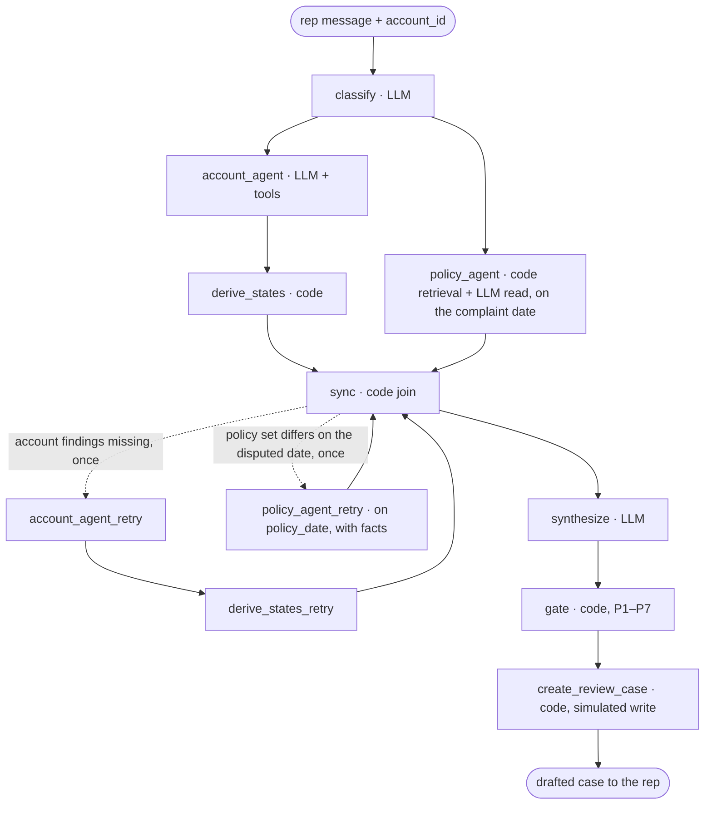

# Plan: The orchestrator graph, back to the v0.4 shape

## 1. Status

- **Version 1.0, 2026-10-26.** The fifth slice. Returns the architecture to the **v0.4 shape**: a LangGraph orchestrator that fans out to the Account Agent and the Policy Agent **in parallel**, a **sync join node** that cross-checks both results and may send **one bounded re-request to each agent** ("clarify" to the Account Agent, "re-retrieve" to the Policy Agent), then synthesize, the gate, and `create_review_case`. Everything built since v0.4 stays: the gate's own P1–P7 checks (D7), the ambiguity split (D9), sync's flags and `lean`, synthesize's per-call constrained draft schema.
- Follows `docs/plans/sync-synthesize.md` v1.1, which is built: 148 offline tests green, dev route 11/12 (`runs/eval_20261026T202450Z.json`).
- **Supersedes** v0.5's "fixed and sequential" D0 and the plain-function `pipeline.investigate`. The orchestrator becomes a real `StateGraph`, so one run is one parent trace in LangSmith with every agent, the sync step and the gate as child runs.
- Decided with Rachit on 2026-10-26 (do not re-ask):
  - **The system is multi-agent, in the v0.4 sense:** two specialist agents run in parallel under a LangGraph orchestrator and a sync node can send either one back once. This overrides the "simplest thing" rule where the two conflict. A v0.5-style sequential pipeline is not an option.
  - **Code still controls the flow.** LangGraph decides what runs next; the LLM classifies, investigates inside each agent, reads policy, and synthesizes. No LLM supervisor.
  - **Keep the v0.5 changes to the gate, sync and synthesize.** Only their wiring changes.

## 2. Why & goal

**Context.** v0.5 made the agents sequential so the Policy Agent could read the disputed event's date before retrieving. That made the outer graph a straight chain, and the diagram stopped looking like the multi-agent system Rachit wants to present. v0.4's shape had the two agents in parallel with a sync join that repaired a date mismatch by one re-request. This slice rebuilds that shape with the pieces that now exist.

**The bet.** With the Policy Agent reading policy on the complaint date and without the account facts, route accuracy on the 12 dev scenarios stays at 11/12 or better and no citation leaves the shown set, because the gate runs its own checks and the synthesize prompt still sees every fact. If accuracy drops, the eval table says where, and that is the v1 → v2 story.

**Use case:**

```bash
.venv/bin/python -m dispute_agent ask A-1002 "cust got hit w a late fee on oct but says he paid over the phone last tues, conf # ends in 8812"
```

Prints what it prints today, plus the sync line `account attempts: 1  policy attempts: 1` and a final `create_review_case: C-004 created=True`. In LangSmith it is **one** run named `dispute A-1002` with children `classify`, `account_agent`, `policy_agent`, `derive_states`, `sync`, `synthesize`, `gate`, `create_review_case`.

**This plan covers:** the `StateGraph` in `pipeline.py`, the Policy Agent running without facts, sync's date-mismatch flag, the two retry paths, `create_review_case`, eval and `ask` output, tests, docs, and the diagram redraw. Nothing else.

## 3. Definition of Done

### Acceptance criteria

```bash
# A1 no-LLM tests, whole suite (148 today + new)
.venv/bin/python -m pytest tests -q
# A2 size fence
for f in dispute_agent/pipeline.py dispute_agent/create_review_case.py tests/test_pipeline.py; do [ "$(wc -l < "$f")" -le 220 ] || exit 1; done
# A3 one real run, one parent trace (needs .env)
.venv/bin/python -m dispute_agent ask A-1002 "cust got hit w a late fee on oct but says he paid over the phone last tues, conf # ends in 8812"
# A4 dev set: thresholds hold; prints send-backs and re-retrieves; exit 0
.venv/bin/python -m dispute_agent eval --min-disputed-acc 0.75 --min-policy-recall 0.75 --min-route-acc 0.75
# A5 only inventory files changed
git status --porcelain
```

- **If A4 drops below today's 11/12 route:** stop, read the traces, report the pattern. **At most one change to `POLICY_SYSTEM`** (the prompt that now reads policy without facts) inside this plan, before/after runs named. No change to `SYNTHESIZE_SYSTEM` or the Account Agent prompt.
- **Held-out scenarios are never run.**

### Budgets

| Budget | Max |
|---|---|
| New files | 4 (`create_review_case.py`, `tests/test_create_review_case.py`, this plan, the v0.6 PNG) |
| LOC per code file | 220 for `pipeline.py` (the graph), 80 for `create_review_case.py` |
| New dependencies | 0 |
| New CLI flags | 0 |
| New `config.py` constants | 0 (`MAX_ATTEMPTS = 2` stays in `pipeline.py`: graph shape, not a tunable) |
| LLM calls per scenario on the normal path | unchanged: classify, Account Agent loop + finalize, Policy Agent read, synthesize |
| Extra LLM calls on a failure path | one Account Agent run (clarify) and/or one Policy Agent read (re-retrieve), each at most once |
| Prompt changes | 1 (`POLICY_SYSTEM`, only if A4 regresses) |

### Must-handle edge cases

- **Policy Agent runs before the disputed event is known.** It reads on `WORLD_TODAY` (Oct 20, 2026) with basis `complaint_date`, facts rendered as `none yet`. Its rules are advisory, so a read without facts is allowed to be less specific; the gate does not depend on them.
- **Date mismatch (re-retrieve).** After derive, sync compares the in-force section set for the category on the complaint date with the set on `derived.policy_date`. If they differ and `policy_attempts < 2`, the graph re-runs the Policy Agent on `derived.policy_date` with the facts. On the current 16 scenarios the sets never differ (every disputed event is after LF.v3's 2026-05-01 start), so this path fires only on new data; it is covered by an offline test with a synthetic date.
- **Account findings missing (clarify).** Unchanged from S14: if `account_missing` and `account_attempts < 2`, the Account Agent and derive run once more. The Policy Agent is **not** rerun for this; it already ran in parallel.
- **Both re-requests needed.** Clarify first, then re-retrieve on the next sync pass; sync runs at most three times.
- **The second attempt also fails.** The run continues with the sync lean, exactly as today.
- **Join semantics.** The retry paths re-enter sync through **separate nodes** (`account_agent_retry`, `derive_states_retry`, `policy_agent_retry`) with plain edges. Re-entering the original nodes would hit the join barrier and end the run silently (verified in a spike on langgraph 1.7.0).
- **Duplicate case.** `create_review_case` returns `gate.existing_case_id` with `created=False`; S-11 must not create. Otherwise it returns a simulated `C-{n:03d}` and `created=True`; nothing is persisted.
- **Gate rejected.** `create_review_case` still runs: the case is created with the forced `manual_escalation` route. The rep still needs the case.

### Out of scope

- An LLM supervisor, agents as tools, runtime agent selection.
- A third agent. Classify and synthesize stay single calls on the orchestrator.
- Any change to `gate.py` logic, `derive.py`, `account_agent.py`, `tools.py`, `data.py`, the Excel files or the policy files.
- The Opus case-note judge; the code-only baseline; held-out runs.
- **Forbidden by name:** no retry on `budget_hit`, `policy_missing`, a dropped rule, a category mismatch, a synthesize failure or a gate rejection; no code that sets `review_route` from a flag; no second synthesize call.

## 4. File inventory (closed)

| Path | Action | Owns |
|---|---|---|
| `dispute_agent/pipeline.py` | REWRITE | `GraphState`, `build_graph()`, node wrappers, `after_sync()`, `investigate()` (same signature, now invokes the graph), `Investigation` (+ `policy_attempts`, `case`) |
| `dispute_agent/policy_agent.py` | UPDATE | `run_policy_agent(sections, category, rep_message, policy_date, policy_date_basis, account=None, facts=None, …)`; `render_seed` renders `none yet` without facts; `PolicyFindings.policy_date_basis` |
| `dispute_agent/sync.py` | UPDATE | `SyncResult.policy_date_mismatch`; issue text; no lean for it (a re-request fixes it, or it is a dropped-rule issue) |
| `dispute_agent/create_review_case.py` | CREATE | `CaseResult`, `create_review_case()` |
| `dispute_agent/evaluate.py` | UPDATE | `trajectory_ok` and `action_ok` checks; rows gain `policy_attempts`, `case`; totals print `send-backs=N re-retrieves=N` |
| `dispute_agent/__main__.py` | UPDATE | `ask` prints both attempt counts and the case line |
| `tests/test_pipeline.py` | REWRITE | graph order via `stream(stream_mode="updates")`; clarify once; re-retrieve once on a synthetic date; both; never twice |
| `tests/test_policy_agent.py` | UPDATE | the no-facts call; `policy_date_basis` |
| `tests/test_sync.py` | UPDATE | `policy_date_mismatch` true/false |
| `tests/test_create_review_case.py` | CREATE | C-001 closed does not block; C-002 open blocks; C-003 other category does not block |
| `tests/test_evaluate.py` | UPDATE | new checks |
| `docs/architecture.md` | UPDATE → v0.6 | §2, §3b, §3c, §5, mermaid, graph state, D0/D2/D5 revised, "Deliberately not in v1", version note |
| `docs/project_brief.md` | UPDATE → v0.8 | §4 text diagram and the "no retries" lines; §6 trajectory evaluator; tools |
| `docs/diagrams/architecture_v0.6.png` | CREATE | the v0.4 layout with v0.5's gate, sync and synthesize text; render source stays in the scratchpad |
| `README.md` | UPDATE | step table; "Not built yet" row removed |
| `docs/plans/orchestrator.md` | CREATE | this plan |

**Read first:** `docs/architecture.md` §2–§3c and D0/D5; `pipeline.py`, `sync.py`, `policy_agent.py` (`render_seed`, `run_policy_agent`), `gate.py` (`find_duplicate`, `GateResult`), `tests/test_pipeline.py` (fakes), `docs/plans/sync-synthesize.md` S14.

## 5. Closed decisions

| # | Decision | Why this, not X |
|---|---|---|
| O1 | **Parallel fan-out; the Policy Agent reads on the complaint date without facts** | Rachit's call: the v0.4 shape. The cost is a less specific first read; the rules are advisory (D7) so correctness does not rest on them |
| O2 | **Sync decides re-requests by two code flags, each bounded to one extra run:** `account_missing` → clarify; `policy_date_mismatch` (in-force set differs) → re-retrieve | The two failures a second run can actually fix. Comparing the in-force *set*, not the date, means a different date with the same policy never wastes a call |
| O3 | **Dedicated retry nodes with plain edges into sync** | The join barrier swallows a re-entry through the original nodes (spike). Retry nodes also make the trace read honestly: `account_agent_retry` is a run name |
| O4 | **`investigate()` keeps its signature and returns `Investigation`** | `__main__` and `evaluate` change in one place each; tests keep their fakes |
| O5 | **One parent trace per run, named `dispute <label>`; children are node names** | The brief's observability claim. The per-step `run_name` configs go away |
| O6 | **`create_review_case` is a code node that runs after the gate, even on rejection** | The diagram's last step; the only write; the rep still needs the case on escalation |
| O7 | **Simulated case IDs are `C-{len(cases)+1:03d}` and nothing is persisted** | Idempotent across the dataset's cases; repeatable in tests; the brief says simulated |

## 6. The graph



```python
class GraphState(TypedDict):
    rep_message: str; account_id: str
    category: Category
    account: dict | None; derived: DerivedFacts | None
    policy: PolicyFindings | None
    sync: SyncResult | None
    synthesis: SynthesisResult | None; gate: GateResult | None; case: CaseResult | None
    account_attempts: int; policy_attempts: int

def after_sync(s) -> Literal["account_agent_retry", "policy_agent_retry", "synthesize"]:
    if s["sync"].account_missing and s["account_attempts"] < MAX_ATTEMPTS: return "account_agent_retry"
    if s["sync"].policy_date_mismatch and s["policy_attempts"] < MAX_ATTEMPTS: return "policy_agent_retry"
    return "synthesize"
```

Edges: `START→classify`; `classify→account_agent`, `classify→policy_agent`; `account_agent→derive_states`; `add_edge(["derive_states","policy_agent"],"sync")`; `sync→after_sync`; `account_agent_retry→derive_states_retry→sync`; `policy_agent_retry→sync`; `synthesize→gate→create_review_case→END`.

## 7. Order of work

1. `policy_agent.py`: the no-facts call and `policy_date_basis`; tests.
2. `sync.py`: `policy_date_mismatch`; tests.
3. `create_review_case.py`; tests.
4. `pipeline.py`: the graph; `test_pipeline.py` rewritten; suite green (A1, A2).
5. `__main__.py`, `evaluate.py`; one `ask` (A3); dev eval (A4); compare with `runs/eval_20261026T202450Z.json`.
6. `architecture.md` v0.6, brief v0.8, README.
7. Diagram v0.6 from the v0.4 layout; check for text overflow; PNG only into `docs/diagrams/`.
8. Commit.
